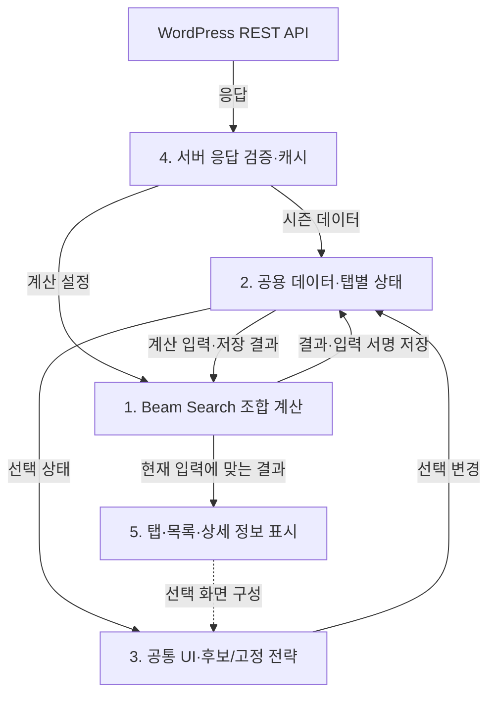
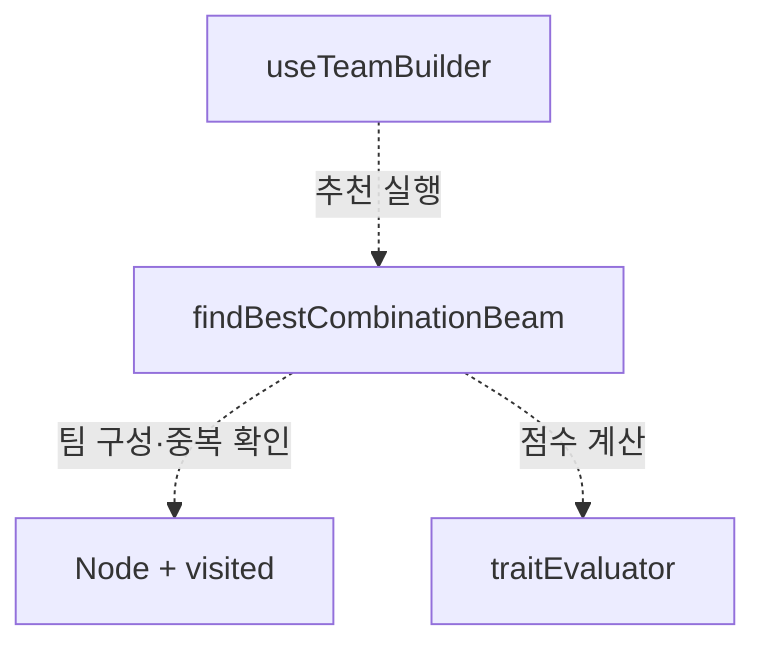
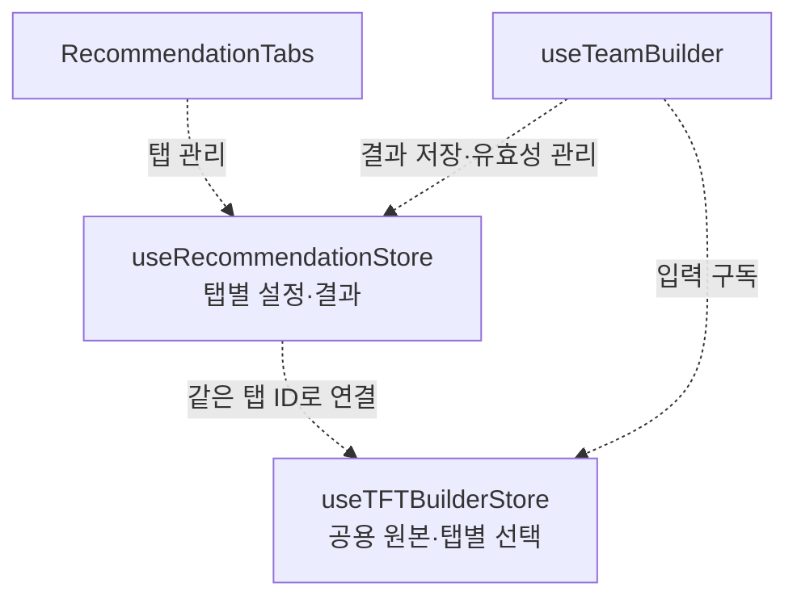
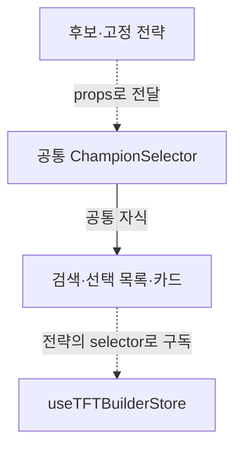
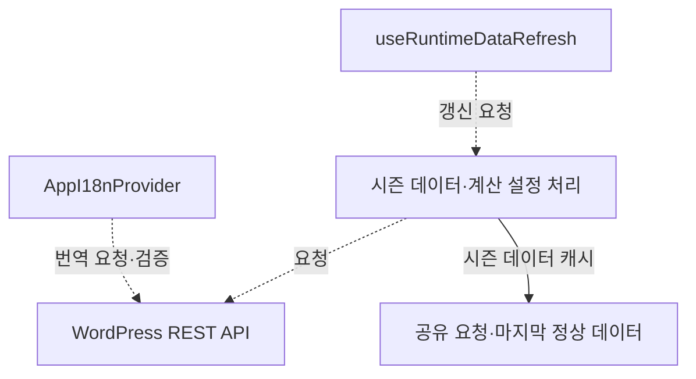
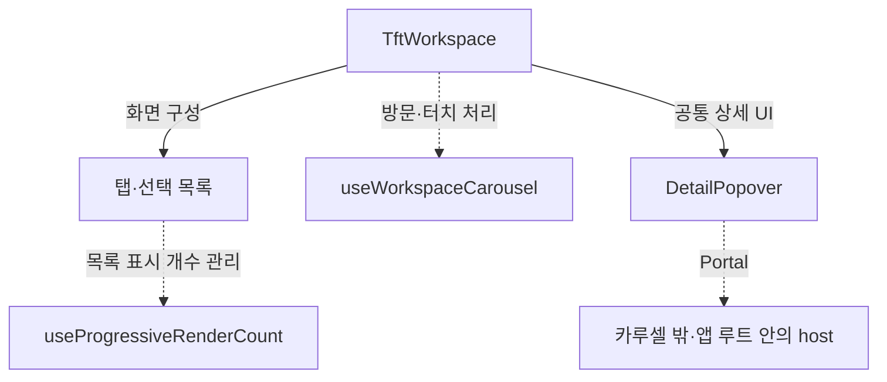

# TFT 팀 조합 추천기

1인 개발 · 2026.01.05 ~ 2026.07.20

후보 유닛·고정 유닛·추가 상징을 바탕으로 점수가 높은 팀을 추천합니다. React 코드를 WordPress 웹과 Capacitor 기반 Android 앱에서 함께 사용하고, 시즌 데이터와 계산 설정은 WordPress REST API로 받습니다.

**기술 스택:** React 19 · TypeScript · Vite · Zustand · Tailwind CSS · WordPress REST API · Capacitor

## 전체 구조

1~5번 설계의 데이터 흐름입니다. 실선은 데이터·상태 전달과 변경 요청, 점선은 화면 구성 관계입니다.

## 1. 알고리즘 — 탐색 범위 제한

**처음 방식:** 처음에는 카드 하나를 노드로, 두 카드 사이의 비활성화된 특성 수를 간선 비용으로 두고 다익스트라로 조합을 찾는 방법을 생각했습니다. 비활성 특성이 적은 경로를 찾으면 팀의 특성을 잘 맞출 수 있을 것이라 봤습니다.

**발생 문제:** 이 모델에서는 시작 카드가 경로에 반드시 포함되고, 원하는 인원만큼 유닛을 고르는 조건도 별도로 필요했습니다. 두 카드만으로 누적 비용이 0이면 그 목적지까지는 이미 최소이므로, 제가 여기에 `0이면 종료` 조건을 붙인다면 두 장에서 끝날 수 있었습니다. 다만 다익스트라 자체가 비용 0에서 전체 탐색을 멈추거나, 모든 카드가 연결됐다는 이유로 경로가 항상 1~3장으로 제한되는 것은 아닙니다. 더 근본적으로 특성의 활성 여부는 팀 전체와 상징에 따라 달라져, 두 카드 사이의 고정 비용만으로 평가하기 어려웠습니다.

**최종 해결:** 그래서 팀 전체를 하나의 상태로 보고, 유닛을 추가할 때마다 점수가 높은 일부 팀만 남기는 Beam Search를 적용했습니다. 특성 활성 구간·OP·코스트·역할군으로 평가하고, 정렬된 팀 ID와 `visited`로 중복 경로를 제거했습니다. 같은 `baseId`의 변형 유닛도 한 팀에 들어가지 않게 했습니다.

**개선 결과:** 후보 `n`명 중 추가할 인원이 `r`명일 때, 완전 탐색은 완성 팀 `C(n, r)`개를 평가하지만 빔 서치는 실제 탐색 폭 `w`를 기준으로 최대 `w × n × r`번의 확장을 시도합니다. 탐색 폭으로 작업량을 조절할 수 있게 됐으며, 최적해를 보장하지 않는 대신 계산 범위를 제한했습니다.

시간 복잡도 비교

`n`은 후보 수, `r`은 고정 유닛을 제외하고 추가할 인원, `w`는 실제 탐색 폭 `max(1, beamWidth, resultLimit)`입니다. 고정 유닛이 없으면 `r`이 목표 팀 인원과 같습니다. `1 ≤ r ≤ n`이고 변형 유닛 등의 제한이 없는 경우를 기준으로 비교했습니다.

| 비교 기준 | 완전 탐색 | Beam Search |
|---|---|---|
| 탐색 규모 | 완성 조합 `C(n, r)`개 | 최대 `w × n × r`번의 확장 시도 |
| 점수 평가 비용 포함 | `O(C(n, r) × E)` | `O(w × n × r × E)` |

여기서 `E`는 최대 팀 크기를 기준으로 한 점수 평가 비용의 상한입니다. 빔 서치는 중간 단계의 부분 팀도 평가하므로, 두 방식의 평가 비용이 매번 정확히 같다는 뜻은 아닙니다. 공통 평가 비용을 묶어 탐색 규모를 비교한 것이며, 비용을 빼거나 상쇄한 것은 아닙니다.

현재 구현에는 팀 ID를 정렬하는 `Node` 생성과 단계별 후보 팀 정렬도 있습니다. 최대 팀 인원을 `K`라 하면 탐색 루프의 시간 상한은 `O(w × n × r × (K log K + E + log(w × n)))`입니다. 팀 내부 정렬과 빔 후보들 사이의 정렬은 서로 다른 작업이므로 같은 비용으로 지울 수 없습니다. 초기 팀 평가·Map 구성·최종 결과의 상세 정보 생성 비용은 이 루프 분석에서 제외했습니다.

컴포넌트·모듈 구조도

코드: [탐색](./vite-project/src/features/core/beamSearchOptimizer.ts) · [팀 상태](./vite-project/src/features/core/Node.ts) · [점수](./vite-project/src/features/core/traitEvaluator.ts)

## 2. 상태 관리 — 공용 원본과 탭별 작업 분리

**처음 방식:** 처음에는 하나의 추천 작업을 기준으로 후보·고정·상징 선택과 추천 결과를 관리했습니다.

**발생 문제:** `+`로 추천 탭을 추가하면서 작업마다 선택과 결과를 따로 유지해야 했습니다. 결과를 보관하더라도 사용자 입력이나 서버의 계산 조건이 바뀌면 그대로 보여 줄 수는 없었습니다.

**최종 해결:** 챔피언·특성 원본은 공유하고, 선택 ID·상징·인원·옵션·결과는 탭 ID별로 나눴습니다. 선택 action에서 후보·고정의 동일 `baseId` 중복을 제거하고, 결과에는 입력 비교용 문자열인 `signature`를 함께 저장했습니다. 현재 입력과 다르면 결과를 숨기고 무효화하며, 팀 인원·섞기 옵션 변경 시에는 즉시 초기화했습니다.

**개선 결과:** 탭을 이동해도 작업을 이어 갈 수 있게 됐습니다. 복사할 때는 선택 Set·Map을 새로 만들고 결과는 비워 작업 간 간섭을 막았습니다. 원본 크기 `D`, 탭 수 `T`, 탭당 상태 크기 `S`일 때 저장 공간은 대략 `O(D + T × S)`입니다. 선택·추천 상태는 메모리에만 보관하므로 페이지 재로딩 시 초기화됩니다.

컴포넌트·모듈 구조도

코드: [선택 store](./vite-project/src/features/store/useTFTBuilderStore.ts) · [추천 store](./vite-project/src/features/team-builder/recommendationStore.ts) · [입력 비교](./vite-project/src/features/team-builder/recommendationSignature.ts)

## 3. 선택 화면 — Strategy로 동작 연결

**처음 방식:** 후보·고정 화면은 공통 `ChampionSelector`로 만들고, 모드에 따라 사용할 목록과 함수를 골랐습니다.

**발생 문제:** 화면을 복사하지는 않았지만 모드 조건이 여러 곳에 흩어져, 목록·선택·표시 설정을 바꿀 때 확인할 범위가 넓어졌습니다.

**최종 해결:** 공통 화면은 유지하고 차이만 전략 객체로 모았습니다. 후보는 `selectedChampions`·`toggle`·`clearSelected`, 고정은 `fixedChampions`·`toggleFixed`·`clearFixed`를 연결했습니다.

**개선 결과:** 검색·카드는 한 곳에서 수정하고, 화면별 동작과 표시 설정은 `selectorStrategies.ts`에서 확인할 수 있게 됐습니다.

컴포넌트·모듈 구조도

코드: [전략 설정](./vite-project/src/features/selector/champion-selector/selectorStrategies.ts) · [공통 화면](./vite-project/src/features/selector/champion-selector/ChampionSelector.tsx)

## 4. 서버 데이터 — 검증과 마지막 정상 데이터 유지

**처음 방식:** 처음에는 받아온 JSON을 필요한 형태로 가공해 store에 넣었습니다.

**발생 문제:** 시즌 데이터와 설정을 서버에서 갱신하도록 구성하면서, 요청 성공만으로 앱에서 사용할 수 있는 응답인지 판단할 수 없었습니다. 정상 사용 중 재요청이 실패하는 경우도 고려해야 했습니다.

**최종 해결:** WordPress가 정규화한 응답을 검사한 뒤 내부 모델로 변환하고, 요청을 공유해 중복 호출을 줄였습니다. 재요청에 실패하면 마지막 정상 데이터를 사용하되, 정상 데이터가 없으면 오류를 표시했습니다. 계산 설정은 허용 범위로 보정하고 번역 누락은 기본 문구로 보완했습니다.

**개선 결과:** 일시적 갱신 실패에도 기존 화면을 유지할 수 있게 됐습니다. 화면 복귀·포커스·온라인 이벤트로 재확인하며 15초 이내 중복 이벤트는 건너뜁니다. 호환되는 데이터는 Android 재빌드 없이 갱신되지만, 필수 키·구조 변경을 자동 변환하지는 않으며 장애 중 오래된 데이터를 표시할 수 있습니다.

컴포넌트·모듈 구조도

코드: [시즌 데이터](./vite-project/src/features/api/tftApi.ts) · [계산 설정](./vite-project/src/features/config/runtimeSettings.ts) · [갱신](./vite-project/src/features/workspace/hooks/useRuntimeDataRefresh.ts) · [번역](./vite-project/src/features/i18n/translationCatalog.ts)

## 5. 화면 사용성 — 초기 생성량과 조작 개선

**처음 방식:** 처음에는 탭 내용과 목록을 한 번에 만들고, 개발 환경에서 기능과 배치를 확인했습니다.

**발생 문제:** WordPress와 Android 환경에서는 스타일 충돌과 초기 화면 생성 부담이 나타났습니다. 세로 스크롤이 탭 이동으로 인식되거나 상세 정보가 부모 영역에 잘리는 문제도 있었습니다.

**최종 해결:** 앱 내부 버튼 스타일을 보정하고, 상위 탭은 처음 방문할 때 내용을 만든 뒤 유지하도록 바꿨습니다. 목록은 일부부터 표시하고, 가로 이동이 충분한 터치만 탭 전환으로 처리했습니다. 상세 정보는 Portal로 카루셀 밖에 표시하며 키보드 이동과 닫기 후 포커스 복귀도 지원했습니다.

**개선 결과:** 처음 만드는 목록 항목 수를 제한하고 상세 정보를 카루셀의 잘림 영역 밖에 표시할 수 있게 됐습니다. 방문한 탭과 추가한 카드 DOM은 유지하므로 메모리는 누적되며, 실제 로딩 시간·프레임 개선율은 별도로 측정하지 않았습니다.

컴포넌트·모듈 구조도

코드: [작업 화면](./vite-project/src/features/workspace/TftWorkspace.tsx) · [목록 생성](./vite-project/src/features/selector/hooks/useProgressiveRenderCount.ts) · [상세 정보](./vite-project/src/features/details/DetailPopover.tsx) · [스타일 보정](./vite-project/src/features/styles/wordpressButtonIsolation.css)
