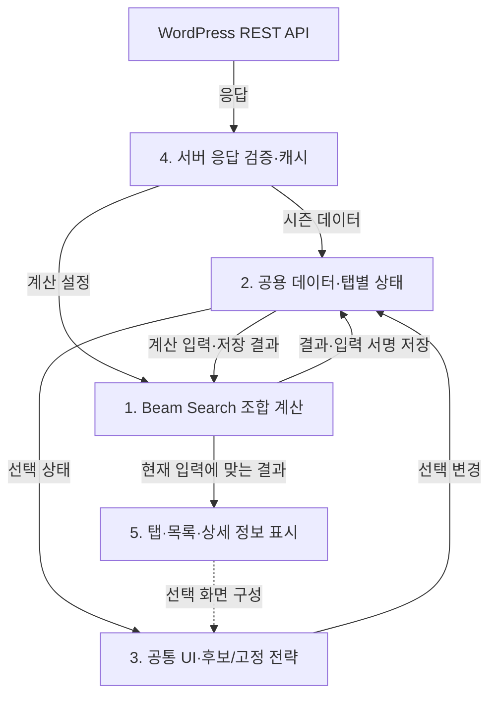
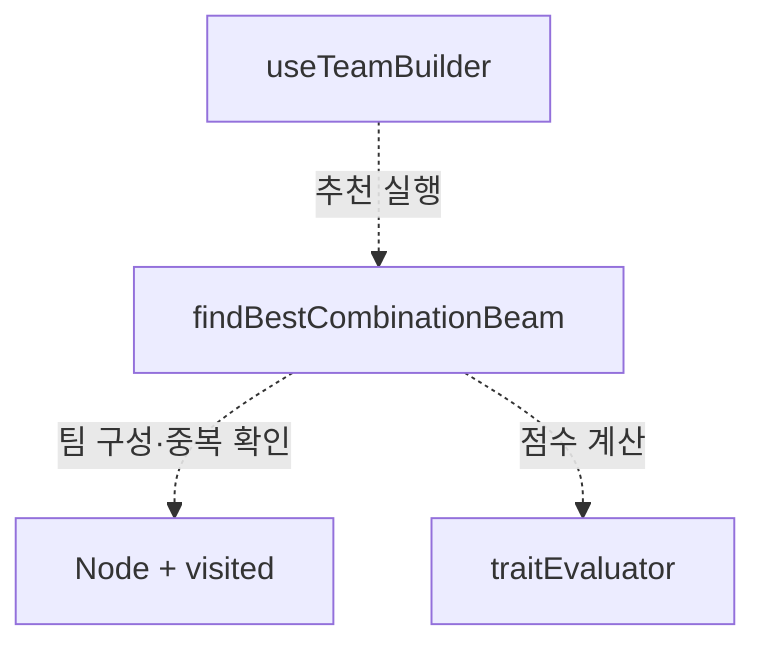
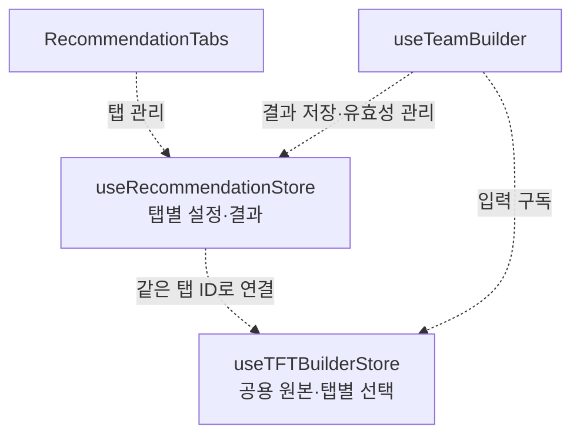
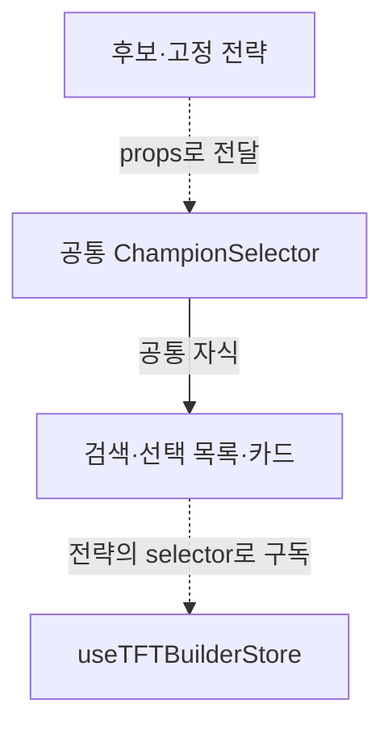
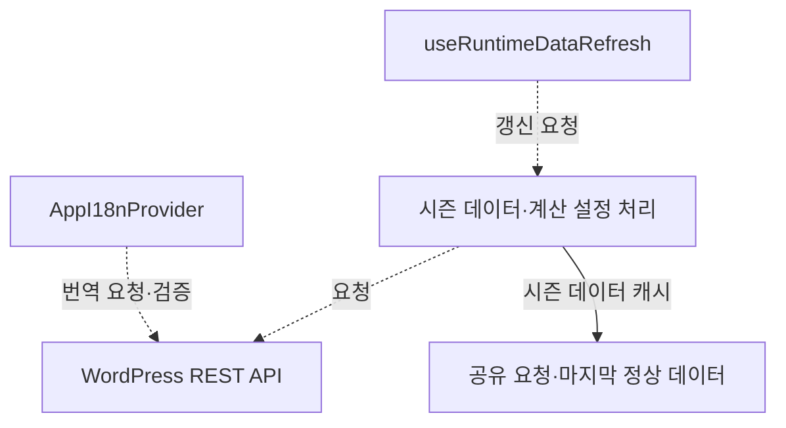
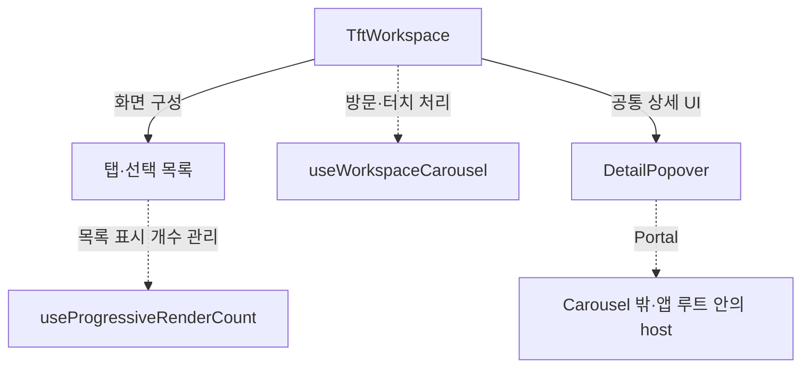

# TFT 팀 조합 추천기

1인 개발 · 2026.01.05 ~ 2026.07.20

후보 유닛·고정 유닛·추가 상징을 바탕으로 점수가 높은 팀을 추천하는 앱을 개발했습니다. 하나의 React 코드를 WordPress 웹과 Capacitor 기반 Android 앱에서 함께 사용하고, 시즌 데이터와 계산 설정은 WordPress REST API로 받도록 구성했습니다.

**기술 스택:** React 19 · TypeScript · Vite · Zustand · Tailwind CSS · WordPress REST API · Capacitor

## 전체 구조

서버 데이터 처리부터 상태 관리·추천 계산·화면 표시까지 다음과 같이 연결했습니다. 실선은 데이터·상태 전달과 변경 요청, 점선은 화면 구성 관계를 나타냅니다.

## 1. 알고리즘 — 탐색 범위 제한

**처음 방식:** 처음에는 후보 `n`명 중 `r`명을 고르는 모든 조합을 평가하는 완전 탐색을 생각했습니다. 조합 수 `C(n, r)`에 따라 계산량이 커져 탐색 범위를 줄일 방법을 찾았고, 카드 하나를 노드로, 두 카드 사이의 비활성화된 특성 수를 간선 비용으로 두는 다익스트라를 검토했습니다.

**발생 문제:** 특성의 활성 여부는 팀 전체와 상징에 따라 달라져, 두 카드 사이의 고정 비용만으로 평가하기 어려웠습니다.

**최종 해결:** 그래서 팀 전체를 하나의 상태로 보고, 유닛을 추가할 때마다 점수가 높은 일부 팀을 다음 단계로 이어 가는 Beam Search를 적용했습니다. 특성 활성 구간·OP·코스트·역할군으로 팀을 평가하고, 정렬된 팀 ID와 `visited`로 중복 경로를 제거했습니다. `baseId`를 기준으로 한 팀에 포함할 유닛의 중복도 확인했습니다.

**개선 결과:** 실제 탐색 폭 `w`를 기준으로 후보 확장 시도를 최대 `w × n × r`번으로 제한했습니다. 여러 팀을 함께 비교하면서 탐색 폭에 따라 계산 범위를 조절할 수 있게 됐습니다.

시간 복잡도 비교

탐색량과 점수 평가 비용을 다음 기호로 정리했습니다.

- `n`: 후보 유닛 수
- `r`: 고정 유닛을 제외하고 추가할 인원. 고정 유닛이 없으면 목표 팀 인원
- `w`: 실제 탐색 폭 `max(1, beamWidth, resultLimit)`
- `C(n, r)`: 후보 `n`명 중 `r`명을 고르는 조합 수
- `T_eval`: 팀 하나의 점수 평가 비용 상한. 최대 팀 크기에서의 특성·상징·OP·코스트·역할군 계산 기준

`1 ≤ r ≤ n`이고 변형 유닛 등의 제한이 없는 조건에서 비교했습니다.

| 비교 기준 | 완전 탐색 | Beam Search |
|---|---|---|
| 탐색 규모 | 완성 조합 `C(n, r)`개 | 최대 `w × n × r`번의 확장 시도 |
| 점수 평가 비용 포함 | `O(C(n, r) × T_eval)` | `O(w × n × r × T_eval)` |

여기에 `Node`의 팀 ID 정렬과 단계별 후보 팀 정렬을 함께 고려했습니다.

- `K`: 고정 유닛을 포함한 최대 팀 인원

탐색 루프의 시간 상한은 `O(w × n × r × (K log K + T_eval + log(w × n)))`로 정리했습니다. `K log K`는 팀 ID 정렬, `T_eval`은 위 표와 같은 점수 평가 비용이며, 단계별 후보 팀 정렬 비용은 전체 식의 `w × n × r × log(w × n)`에 해당합니다.

컴포넌트·모듈 구조도

코드: [탐색](./vite-project/src/features/core/beamSearchOptimizer.ts) · [팀 상태](./vite-project/src/features/core/Node.ts) · [점수](./vite-project/src/features/core/traitEvaluator.ts)

## 2. 상태 관리 — 공용 원본과 탭별 작업 분리

**처음 방식:** 처음에는 하나의 추천 작업을 기준으로 후보·고정·상징 선택과 추천 결과를 관리했습니다.

**발생 문제:** `+`로 추천 탭을 추가하면서 작업마다 선택과 결과를 따로 유지해야 했습니다. 보관한 결과가 현재 선택과 서버의 계산 조건에 맞는지도 함께 확인할 필요가 생겼습니다.

**최종 해결:** 챔피언·특성 원본은 공유하고, 선택 ID·상징·인원·옵션·결과는 탭 ID별로 나눴습니다. 선택 action에서 후보·고정의 동일 `baseId` 중복을 제거하고, 결과에는 입력 비교용 문자열인 `signature`를 함께 저장했습니다. 현재 입력과 다르면 결과를 숨기고 무효화하며, 팀 인원·섞기 옵션 변경 시에는 즉시 초기화했습니다.

**개선 결과:** 탭을 이동해도 선택과 결과를 이어서 사용할 수 있게 됐습니다. 복사할 때는 선택 Set·Map을 새로 만들고 결과를 비워 각각 독립된 작업으로 시작하도록 했습니다. 공용 원본을 공유하고 탭별 작업 상태를 분리했습니다. 원본 크기 `D`, 탭 수 `T`, 탭당 상태 크기 `S`를 기준으로 저장 공간은 대략 `O(D + T × S)`입니다.

컴포넌트·모듈 구조도

코드: [선택 store](./vite-project/src/features/store/useTFTBuilderStore.ts) · [추천 store](./vite-project/src/features/team-builder/recommendationStore.ts) · [입력 비교](./vite-project/src/features/team-builder/recommendationSignature.ts)

## 3. 선택 화면 — Strategy로 동작 연결

**처음 방식:** 후보·고정 화면은 공통 `ChampionSelector`로 만들고, 모드에 따라 사용할 목록과 함수를 골랐습니다.

**발생 문제:** 모드별 조건이 여러 곳에 흩어지면서, 목록·선택·표시 설정을 바꿀 때 연결 관계를 여러 파일에서 확인해야 했습니다.

**최종 해결:** 공통 화면은 유지하고 차이만 전략 객체로 모았습니다. 후보는 `selectedChampions`·`toggle`·`clearSelected`, 고정은 `fixedChampions`·`toggleFixed`·`clearFixed`를 연결했습니다.

**개선 결과:** 공통 검색·카드를 수정하면 두 화면에 함께 반영되도록 정리했습니다. 화면별 동작과 표시 설정도 `selectorStrategies.ts`에 모아 수정할 위치를 명확히 했습니다.

컴포넌트·모듈 구조도

코드: [전략 설정](./vite-project/src/features/selector/champion-selector/selectorStrategies.ts) · [공통 화면](./vite-project/src/features/selector/champion-selector/ChampionSelector.tsx)

## 4. 서버 데이터 — 검증과 마지막 정상 데이터 유지

**처음 방식:** 처음에는 받아온 JSON을 필요한 형태로 가공해 store에 넣었습니다.

**발생 문제:** 시즌 데이터와 설정을 서버에서 갱신하도록 구성하면서, 응답이 앱에서 사용할 수 있는 형태인지 확인하는 과정이 필요했습니다. 재요청 중 연결이 끊겨도 기존 화면을 이어 갈 방법도 함께 마련하고자 했습니다.

**최종 해결:** WordPress가 정규화한 응답을 검사한 뒤 내부 모델로 변환하고, 요청을 공유해 중복 호출을 줄였습니다. 정상 응답은 보관해 재요청에 실패했을 때 활용하도록 했습니다. 계산 설정은 허용 범위로 보정하고 번역 누락은 기본 문구로 보완했습니다.

**개선 결과:** 일시적으로 연결이 끊겨도 앞서 받은 정상 데이터로 화면을 이어 갈 수 있게 됐습니다. 화면 복귀·포커스·온라인 이벤트에서 데이터를 재확인하고, 15초 기준으로 중복 요청을 줄였습니다. 기존 응답 구조와 호환되는 데이터는 Android 앱을 다시 빌드하지 않고 갱신해 받도록 구성했습니다.

컴포넌트·모듈 구조도

코드: [시즌 데이터](./vite-project/src/features/api/tftApi.ts) · [계산 설정](./vite-project/src/features/config/runtimeSettings.ts) · [갱신](./vite-project/src/features/workspace/hooks/useRuntimeDataRefresh.ts) · [번역](./vite-project/src/features/i18n/translationCatalog.ts)

## 5. 화면 사용성 — 초기 생성량과 조작 개선

**처음 방식:** 처음에는 탭 내용과 목록을 한 번에 만들고, 개발 환경에서 기능과 배치를 확인했습니다.

**발생 문제:** WordPress와 Android 환경에서는 스타일 충돌과 초기 화면 생성 부담이 나타났습니다. 세로 스크롤이 탭 이동으로 인식되거나 상세 정보가 부모 영역에 잘리는 문제도 있었습니다.

**최종 해결:** 앱 내부 버튼 스타일을 보정하고, 상위 탭은 처음 방문할 때 내용을 만든 뒤 유지하도록 바꿨습니다. 목록은 일부부터 표시하고, 가로 이동이 충분한 터치만 탭 전환으로 처리했습니다. 상세 정보는 Portal로 Carousel 밖에 표시하고, 키보드 탭 이동과 닫기 후 포커스 복귀도 처리했습니다.

**개선 결과:** 처음 만드는 목록 항목 수를 조절하고, 방문한 탭의 내용은 재방문할 때 다시 활용할 수 있게 됐습니다. 상세 정보도 Carousel의 잘림 영역 밖에 배치해 목록과 함께 확인할 수 있도록 했습니다.

컴포넌트·모듈 구조도

코드: [작업 화면](./vite-project/src/features/workspace/TftWorkspace.tsx) · [목록 생성](./vite-project/src/features/selector/hooks/useProgressiveRenderCount.ts) · [상세 정보](./vite-project/src/features/details/DetailPopover.tsx) · [스타일 보정](./vite-project/src/features/styles/wordpressButtonIsolation.css)
