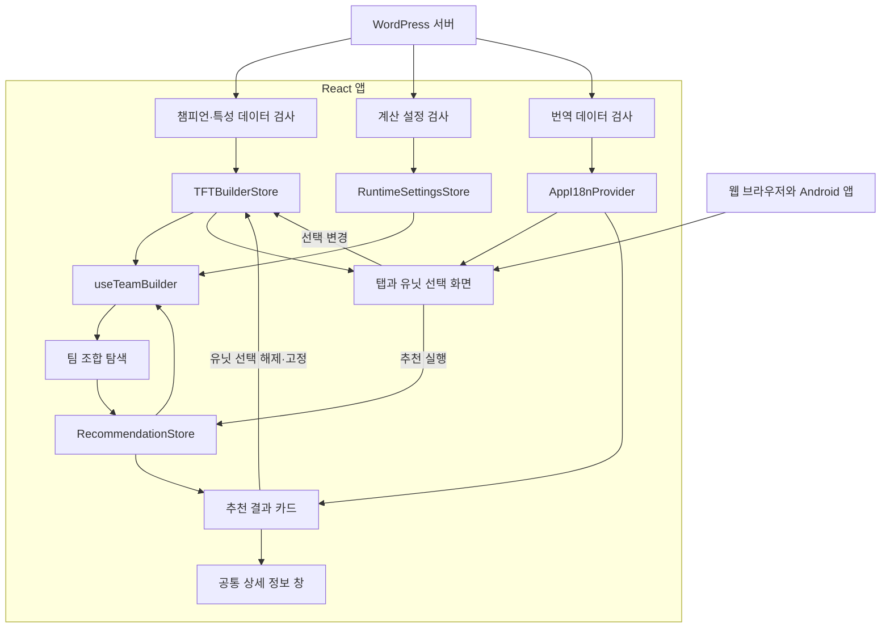
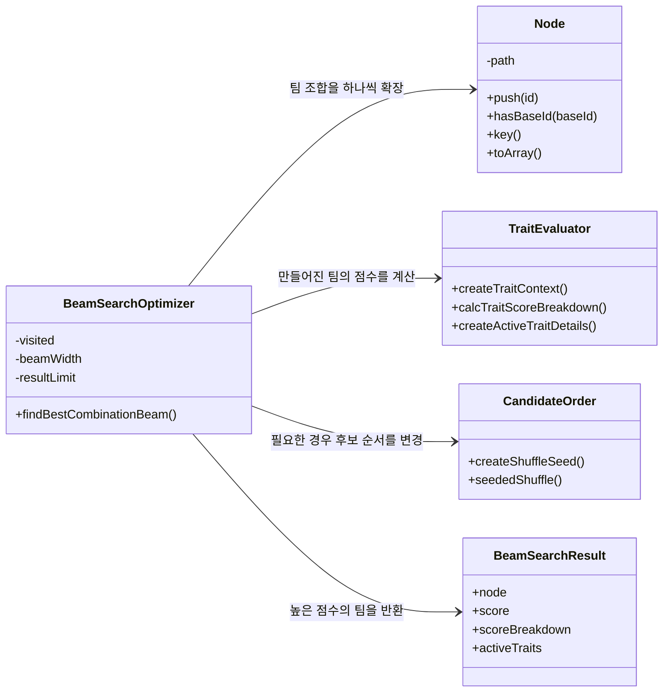
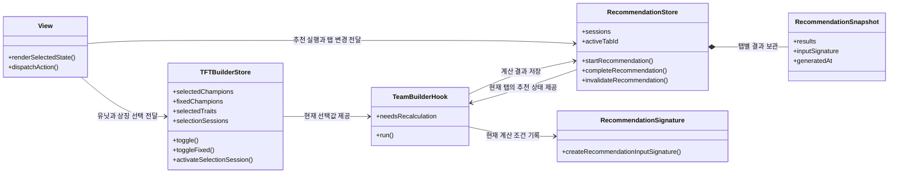
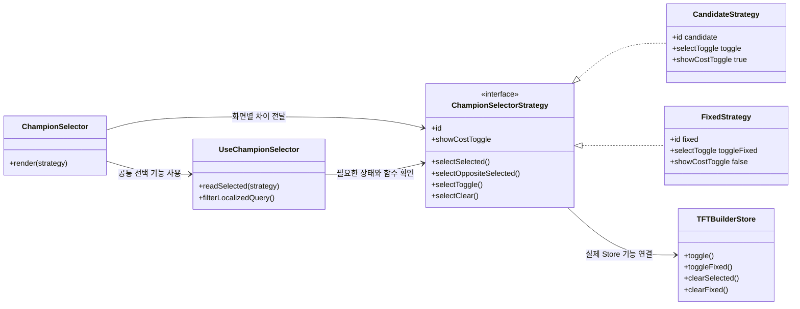
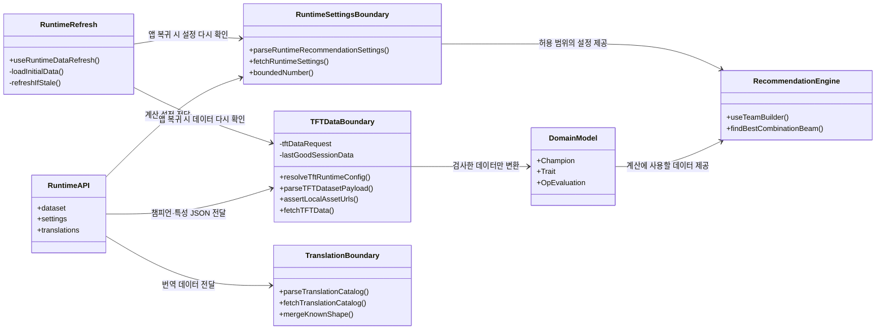
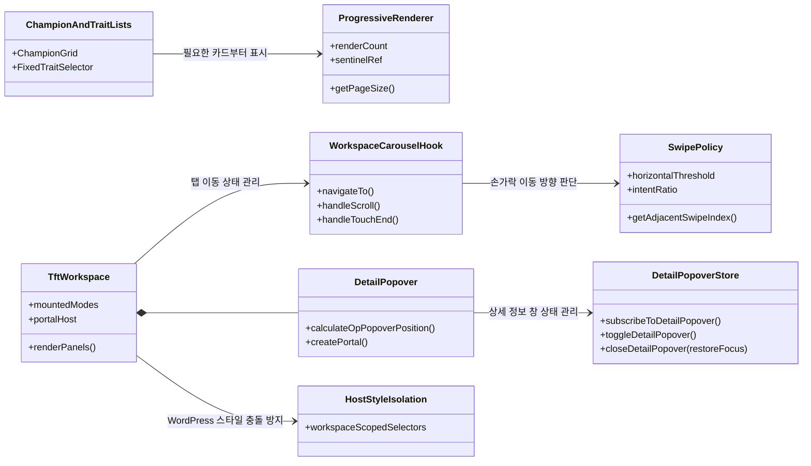

# TFT 팀 조합 추천기 — 프로젝트 소개와 주요 설계

1인 개발 프로젝트 · 2026.01.05 ~ 진행 중

사용자가 고른 **후보 유닛**, 반드시 포함할 **고정 유닛**, 추가로 적용할 **상징**을 바탕으로 점수가 높은 팀 조합을 추천하는 React 애플리케이션입니다.

하나의 프런트엔드 코드를 **WordPress 웹과 Android 앱에서 함께 사용**하고 있으며, 챔피언·특성과 같은 시즌 데이터와 추천 계산에 사용하는 설정값은 서버에서 받아오도록 구성했습니다.

핵심 사용 흐름은 챔피언을 선택하고 계산 버튼을 눌러 추천 결과를 확인하는 비교적 단순한 구조입니다. 하지만 실제 구현에서는 후보가 늘어날 때의 계산량, 추천 탭별 상태 분리, 현재 입력과 이전 결과의 일치 여부를 함께 다뤄야 했습니다.

후보 유닛 화면과 고정 유닛 화면은 UI 대부분을 공유하면서도 서로 다른 상태와 동작을 사용합니다. 서버에서 데이터를 받아 사용하는 구조에서는 HTTP 요청 성공 여부뿐 아니라 응답 내용이 앱이 기대하는 형태인지도 확인해야 했습니다.

개발 서버에서는 정상적으로 보이던 버튼과 화면이 WordPress에 올리면 다르게 보이거나, 모바일에서 세로로 스크롤하려던 동작이 탭 이동으로 처리되는 문제도 직접 겪었습니다.

이런 문제를 하나씩 수정하다 보니 기능을 계속 덧붙이는 것보다 **계산은 계산대로, 상태 관리는 상태 관리대로, 서버 데이터 처리는 서버 데이터대로, 화면은 화면대로 역할을 나누는 것이 필요하다**고 판단했습니다.

그래서 각 기능을 독립적인 **모듈(Module)**로 나누고, 어떤 데이터가 어디에서 만들어지고 어디로 전달되는지도 함께 정리했습니다. 서로 다른 역할을 한곳에 섞지 않고 나누는 이러한 방식을 **관심사 분리(Separation of Concerns)**라고 볼 수 있습니다.

현재 `src/features`의 코드를 기준으로, 구현할 때 고려한 제약과 이를 해결하기 위해 적용한 설계를 다섯 가지로 정리했습니다.

각 항목은 가능한 한 다음과 같은 흐름이 이어지도록 구성했습니다.

> **어떤 제약이 있는지 → 현재 코드가 어떻게 처리하는지 → 그 결과와 트레이드오프는 무엇인지**

---

## 전체 구조



현재 구조는 크게 **데이터 불러오기, 계산, 상태 관리, 화면**의 네 영역으로 나누었습니다.

| 영역 | 담당하는 역할 | 대표 코드 |
|---|---|---|
| 데이터 불러오기 | 서버에서 데이터를 받아오고, 실제로 사용해도 되는 데이터인지 확인한 뒤 앱에 전달 | [`api/tftApi.ts`](./api/tftApi.ts), [`config/runtimeSettings.ts`](./config/runtimeSettings.ts) |
| 계산 | 챔피언과 특성 정보를 이용해 팀의 점수를 계산하고 높은 점수의 조합을 탐색 | [`domain`](./domain), [`core`](./core) |
| 상태 관리 | 서버 데이터, 탭별 선택값, 추천 결과와 같이 여러 화면에서 함께 사용하는 상태를 관리 | [`store`](./store), [`team-builder/recommendationStore.ts`](./team-builder/recommendationStore.ts) |
| 화면 | 유닛 선택, 다국어, 탭 이동, 상세 정보 창처럼 사용자가 직접 보고 조작하는 부분을 담당 | [`selector`](./selector), [`i18n`](./i18n), [`workspace`](./workspace), [`details`](./details) |

이렇게 나누고 나니 문제가 생겼을 때 계산 문제인지, 상태 문제인지, 서버 데이터 문제인지, 화면 문제인지 구분하기가 이전보다 쉬워졌습니다.

---

## 기술 스택

- React 19
- TypeScript
- Vite
- Zustand를 이용한 상태 관리
- Tailwind CSS
- WordPress 전역 스타일과의 충돌을 줄이기 위한 별도 CSS
- WordPress REST API를 이용한 서버 데이터 전달
- Capacitor Android WebView

---

# 주요 설계 5가지

## 1. 알고리즘 — 조합 폭발을 Beam Search로 제한했다

### 문제 정의

팀 추천에서 가장 단순한 방법은 가능한 팀 조합을 모두 만들어 점수를 계산한 뒤 가장 높은 점수의 팀을 선택하는 것입니다.

가능한 경우를 처음부터 끝까지 모두 확인하는 방식을 **완전 탐색(Brute Force)**이라고 합니다. 모든 조합을 직접 확인하기 때문에 가장 좋은 결과를 확실하게 찾을 수 있다는 장점이 있습니다.

### 완전 탐색의 한계

하지만 후보 유닛의 수가 늘어나면 계산량이 빠르게 커집니다.

후보 50명 중 8명을 선택하는 경우만 계산해도 가능한 조합이 **536,878,650개**가 됩니다.

이는 코드 한두 줄의 속도보다 **확인해야 하는 조합 자체가 너무 빠르게 늘어나는 구조**의 문제입니다.

후보가 조금만 늘어나도 확인할 조합의 수가 크게 증가하는 이런 현상을 **조합 폭발(Combinatorial Explosion)**이라고 합니다.

모든 조합을 확인하면 좋은 결과를 정확하게 찾을 수 있지만, 실제 웹이나 모바일 환경에서 사용하기에는 계산량이 너무 커질 수 있었습니다.

### 현재 구현: Beam Search

현재 코드는 모든 조합을 끝까지 유지하지 않고, 챔피언을 한 명씩 추가하면서 **현재 점수가 높은 일부 조합만 다음 단계로 넘깁니다.**

이 방식으로 사용한 것이 **Beam Search**입니다.

현재 구현에서는 다음 흐름으로 계산합니다.

```text
챔피언을 한 명 추가
↓
현재 만들어진 팀들의 점수를 계산
↓
점수가 높은 일부 팀만 남김
↓
남은 팀에 다시 챔피언을 추가
↓
필요한 팀 인원이 될 때까지 반복
```

따라서 모든 경우를 끝까지 확인하지 않고, 중간 단계에서 가능성이 낮은 조합을 계속 줄입니다.

Beam Search는 모든 조합을 완전히 검사하는 알고리즘은 아닙니다. 대신 탐색할 범위를 줄여 실제로 사용할 수 있는 시간 안에 좋은 결과를 찾는 **휴리스틱 탐색(Heuristic Search)** 방식입니다.

이 때문에 계산 속도는 크게 줄일 수 있지만 항상 이론적으로 가장 높은 점수의 조합을 찾는다고 보장할 수는 없습니다.

### 같은 팀을 여러 번 계산하는 문제도 함께 줄였다

현재 구현에서는 같은 팀이 선택 순서만 다르게 만들어지는 경우도 중복으로 계산하지 않아야 합니다.

```text
A → B → C
B → A → C
```

위 두 경우는 만들어진 순서는 다르지만 최종 팀은 같습니다.

그래서 챔피언 ID를 일정한 순서로 정렬해 팀마다 같은 **고유 key**가 만들어지도록 했습니다. 이미 계산한 key가 있다면 같은 팀을 다시 탐색하지 않습니다.

같은 챔피언에서 파생된 변형 유닛도 `baseId`를 확인해 한 팀에 중복으로 포함되지 않도록 처리했습니다.

### 같은 입력에서는 같은 결과가 나오도록 했다

계산할 때마다 후보의 순서가 달라지면 같은 유닛을 선택했는데도 결과가 계속 바뀔 수 있습니다.

기본 상태에서는 같은 입력을 넣었을 때 같은 결과가 나오도록 유지했습니다.

이처럼 **같은 입력에 대해 같은 결과가 만들어지는 성질**을 **결정적 동작(Deterministic Behavior)**이라고 합니다.

후보의 순서를 일부러 섞는 옵션을 켰을 때만 `seed`를 이용해 순서를 변경하도록 했습니다.

그래서 기본 추천 결과는 다시 확인하기 쉽고, 필요할 때만 후보 순서를 바꿔 다른 탐색 흐름을 사용할 수 있습니다.

### 현재 결과

현재 기본 설정에서는 한 단계마다 점수가 높은 **28개의 조합만 남기고**, 계산이 끝난 뒤 최종 **5개의 추천 결과**를 보여 줍니다.

요청한 결과 수를 확보할 수 있도록 실제 단계 폭은 `beamWidth`와 `resultLimit` 중 더 큰 값으로 보정됩니다.

완전 탐색과 비교하면 실제 계산해야 하는 조합의 수가 크게 줄어듭니다.

다만 한 단계에서 남기는 팀의 수를 늘리면 더 많은 조합을 살펴볼 수 있는 대신 계산 시간이 증가합니다.

반대로 남기는 팀의 수를 줄이면 계산은 빨라지지만 높은 점수의 조합을 중간에 제외할 가능성도 커집니다.

결국 이 부분은 **계산 속도와 결과 품질을 어느 정도까지 가져갈 것인지 조절해야 하는 문제**였습니다.

이처럼 한쪽을 높였을 때 다른 쪽에서 비용이 생기는 관계를 **트레이드오프(Trade-off)**라고 합니다.

현재는 이 값을 코드에 완전히 고정하지 않고 WordPress 관리자에서 조절할 수 있도록 만들었습니다.



관련 코드: [`core/beamSearchOptimizer.ts`](./core/beamSearchOptimizer.ts), [`core/Node.ts`](./core/Node.ts), [`core/traitEvaluator.ts`](./core/traitEvaluator.ts), [`core/candidateOrder.ts`](./core/candidateOrder.ts)

---

## 2. 상태 관리 — 공용 Store와 탭별 세션으로 상태를 나눴다

### 처음 방식

초기 구현부터 후보 유닛, 고정 유닛, 상징 선택은 Zustand store에서 함께 관리했습니다. 반면 팀 인원과 추천 결과는 `useTeamBuilder` 내부 상태로 보관해 하나의 추천 작업만 다루는 구조였습니다.

### 개발하면서 생긴 문제

추천 하위 탭을 추가하면서 하나의 선택 상태와 컴포넌트 내부의 추천 결과만으로는 탭마다 다른 작업을 유지할 수 없었습니다.

또한 결과를 전역에 저장하기만 하면 유닛이나 계산 설정을 바꾼 뒤에도 이전 결과가 현재 입력의 결과처럼 보일 수 있었습니다. 따라서 공용 데이터와 탭별 데이터의 범위를 구분하고, 결과가 어떤 입력으로 계산되었는지도 확인할 필요가 생겼습니다.

### 상태 변경을 Store로 모았다

화면은 상태를 직접 여러 군데에서 변경하지 않고, 사용자가 어떤 행동을 했는지만 Zustand store에 전달합니다.

실제 상태를 어떻게 변경할지는 store가 담당합니다.

```text
사용자 행동
↓
화면
↓
Store에 변경 요청
↓
Store에서 상태 변경
↓
변경된 상태를 화면에 다시 표시
```

데이터가 여러 방향으로 서로 변경되는 것이 아니라 한쪽 방향으로 흐르도록 정리한 것입니다.

이 프로젝트에서는 이런 구조를 **Flux 스타일의 단방향 데이터 흐름**으로 사용하고 있습니다.

### 같은 상태는 한곳을 기준으로 사용했다

후보 화면과 고정 화면에서 같은 챔피언 상태를 각각 따로 만들지 않고 같은 store를 기준으로 사용하도록 했습니다.

어떤 챔피언을 고정 유닛으로 선택하면 store에서 `fixedChampions`를 변경하고, 같은 `baseId`를 가진 원본·변형 유닛은 `selectedChampions`에서 제거합니다.

```text
고정 유닛으로 선택
↓
fixedChampions에 추가
↓
같은 baseId의 유닛을 selectedChampions에서 제거
↓
후보 화면과 고정 화면이 같은 변경 결과를 표시
```

이제 후보 화면에서 변경하든 고정 화면에서 변경하든 실제 상태 변경 규칙은 같은 곳을 지나갑니다.

여러 화면에서 같은 데이터를 사용할 때 기준이 되는 상태를 한곳에 두는 개념을 **단일 진실 공급원(Single Source of Truth)**이라고 합니다.

직접 개발하면서는 이 용어 자체보다 **같은 챔피언의 상태를 여러 군데에서 따로 관리하지 않는 것**이 가장 중요했습니다.

### 추천 결과가 현재 선택과 맞는지도 확인했다

추천 결과는 단순히 저장해 두는 것만으로는 부족했습니다.

유닛을 선택하고 추천을 계산한 뒤, 사용자가 후보 유닛이나 고정 유닛을 바꾸면 이전 결과는 더 이상 현재 선택을 기준으로 계산한 결과가 아닙니다.

그래서 추천을 실행할 때 다음 주요 값을 하나의 문자열로 만들어 결과와 함께 저장했습니다.

- 후보 유닛
- 고정 유닛
- 선택한 상징
- 팀 인원
- 후보 섞기 여부
- 서버 계산 설정
- 계산에 참여하는 챔피언 정보와 특성 규칙

이 값을 `signature`라고 사용하고 있습니다.

추천을 계산했을 때의 `signature`와 현재 선택 상태로 다시 만든 `signature`가 다르면, 현재 화면의 입력이 이전 계산과 달라졌다는 것을 알 수 있습니다.

그때는 이전 결과를 그대로 현재 결과처럼 사용하지 않고 다시 계산해야 하는 상태로 처리합니다.

이처럼 이전에 만들어 둔 값이 현재 조건과 맞지 않을 때 더 이상 유효한 값으로 사용하지 않는 처리를 **무효화(Invalidation)**라고 합니다.

### 탭마다 작업 내용은 따로 유지했다

추천 탭을 여러 개 사용할 수 있게 만들면서 모든 탭이 같은 선택값과 결과를 공유해서도 안 됐습니다.

그래서 추천 하위 탭마다 선택 상태와 추천 결과를 따로 저장했습니다.

```text
탭 1
후보 선택 A
추천 결과 A

탭 2
후보 선택 B
추천 결과 B

탭 3
후보 선택 C
추천 결과 C
```

이제 탭을 이동해도 각 탭에서 하던 작업이 그대로 남습니다.

반대로 챔피언과 특성의 원본 데이터처럼 어떤 탭에서도 같은 값을 사용해야 하는 데이터는 공통으로 공유합니다.

### 바꾼 뒤

후보·고정 선택은 `toggle()`과 `toggleFixed()`가 같은 `baseId`의 유닛을 반대 목록에서 제거하므로 두 목록의 배타성이 유지됩니다.

추천 결과 역시 어떤 입력으로 계산된 것인지 함께 확인하기 때문에 선택값을 바꾼 뒤 이전 결과가 그대로 남는 문제를 구분할 수 있게 되었습니다.

개발하면서 느낀 가장 큰 변화는 **화면마다 상태를 맞추려고 따로 처리하는 코드가 줄고, 상태가 잘못되었을 때 어디를 확인해야 하는지가 명확해졌다는 점**입니다.



관련 코드: [`store/useTFTBuilderStore.ts`](./store/useTFTBuilderStore.ts), [`team-builder/recommendationStore.ts`](./team-builder/recommendationStore.ts), [`team-builder/recommendationSignature.ts`](./team-builder/recommendationSignature.ts), [`team-builder/hooks/useTeamBuilder.ts`](./team-builder/hooks/useTeamBuilder.ts)

---

## 3. 선택 화면 구조 — 공통 화면의 조건문을 Strategy로 분리했다

### 처음 방식

초기 구현에서도 후보 유닛 화면과 고정 유닛 화면은 공통 `ChampionSelector`를 사용했습니다. 대신 현재 화면이 후보인지 고정인지 나타내는 `mode`를 컴포넌트와 훅에 전달했습니다.

### 개발하면서 생긴 문제

화면 자체는 하나였지만 `mode === "candidate"` 같은 조건이 훅과 하위 컴포넌트 여러 곳에 퍼져 있었습니다. 화면별 차이가 늘어날수록 어떤 상태와 동작이 각 모드에 연결되는지 여러 파일에서 확인해야 했습니다.

후보 유닛 화면에서는 후보 목록과 `toggle()`을 사용하지만, 고정 유닛 화면에서는 고정 목록과 `toggleFixed()`를 사용합니다.

코스트 필터를 보여 줄지, 어떤 선택 상태를 사용할지도 서로 달랐습니다.

결국 **화면의 대부분은 같은데 일부 동작만 다른 구조**였습니다.

### 공통 화면은 유지하고 차이만 분리했다

검색, 카드 표시, 목록 표시처럼 공통으로 사용하는 컴포넌트 구조는 `ChampionSelector` 하나로 유지했습니다.

화면마다 달라지는 부분만 `ChampionSelectorStrategy`로 따로 분리했습니다.

```text
ChampionSelector
│
├─ 공통 검색
├─ 공통 챔피언 카드
├─ 공통 목록 표시
│
└─ 화면마다 다른 부분은 Strategy에서 결정
   ├─ 후보 유닛 방식
   └─ 고정 유닛 방식
```

후보 유닛 화면을 사용할 때는 후보용 Strategy를 전달하고, 고정 유닛 화면에서는 고정용 Strategy를 전달합니다.

후보용 Strategy에서는 후보 목록과 `toggle()`을 연결하고, 고정용 Strategy에서는 고정 목록과 `toggleFixed()`를 연결했습니다.

### ChampionSelector가 화면의 종류를 직접 판단하지 않도록 했다

이전에는 컴포넌트와 훅이 현재 화면이 후보인지 고정인지 확인하고 조건문으로 사용할 상태와 함수를 선택했습니다. 화면의 차이가 늘어나면 이런 조건문도 계속 늘어날 수 있습니다.

그래서 `ChampionSelector` 자체는 지금 어떤 화면에서 사용되는지 자세히 판단하지 않도록 했습니다.

대신 다음과 같이 필요한 정보만 Strategy를 통해 받습니다.

```text
현재 선택된 유닛은 무엇인지
선택했을 때 어떤 함수를 실행할지
전체 선택을 해제할 때 어떤 함수를 실행할지
코스트 필터를 표시할지
```

Strategy가 일정한 형태로 이런 값과 함수를 전달하도록 약속한 부분이 **인터페이스(Interface)**입니다.

`ChampionSelector`는 인터페이스에 맞는 값만 들어온다면 실제로 후보 화면인지 고정 화면인지 몰라도 같은 방식으로 동작할 수 있습니다.

### Strategy 패턴으로 정리했다

공통 흐름은 그대로 두고 상황마다 달라지는 동작을 외부에서 바꿔 끼우는 구조가 **Strategy 디자인 패턴**입니다.

이 프로젝트에서는 디자인 패턴을 먼저 적용해야겠다고 정한 뒤 코드를 맞춘 것은 아니었습니다.

공통 컴포넌트에 화면별 조건문을 계속 추가하지 않도록 차이를 외부로 분리하다 보니 Strategy 패턴과 맞는 구조가 되었습니다.

### 바꾼 뒤

이제 후보 화면과 고정 화면은 같은 검색 기능과 같은 챔피언 카드 표시 코드를 사용합니다.

공통 부분을 수정하면 두 화면에 함께 반영되고, 서로 다른 동작은 Strategy 안에서 확인할 수 있습니다.

처음보다 파일의 수는 조금 늘었지만, **어떤 부분이 공통이고 어떤 부분이 화면마다 다른지 구분하기가 훨씬 쉬워졌습니다.**

비슷한 선택 화면이 나중에 추가되더라도 기존 화면 전체를 복사하는 대신 관련 타입과 새로운 Strategy를 추가하는 방향으로 확장할 수 있습니다.



관련 코드: [`selector/champion-selector/selectorStrategies.ts`](./selector/champion-selector/selectorStrategies.ts), [`selector/champion-selector/ChampionSelector.tsx`](./selector/champion-selector/ChampionSelector.tsx), [`selector/champion-selector/hooks/useChampionSelector.ts`](./selector/champion-selector/hooks/useChampionSelector.ts)

---

## 4. 서버 데이터 — 서버 요청 성공 여부만 믿지 않고 실제 데이터까지 확인하도록 바꿨다

### 처음 방식

처음에는 서버 요청에 성공하면 전달받은 JSON 데이터를 바로 store에 저장해 사용했습니다.

서버에서 정상적으로 응답했다면 데이터도 정상일 것이라고 생각한 구조였습니다.

### 개발하면서 생긴 문제

서버에서 데이터를 받아 사용하는 부분이 많아지면서 **요청이 성공했다는 것과 데이터가 정상이라는 것은 다른 문제**라는 점이 중요해졌습니다.

HTTP 요청 자체는 성공했어도 필요한 필드가 빠질 수 있고, 이전 시즌 데이터가 전달될 수도 있습니다.

챔피언이나 특성의 개수가 예상과 다를 수도 있고, 숫자가 필요한 위치에 잘못된 값이 들어오거나 이미지 주소가 잘못될 수도 있습니다.

TypeScript를 사용하고 있기 때문에 코드 안에서 잘못된 타입을 사용하는 문제는 어느 정도 미리 확인할 수 있습니다.

이것이 **정적 타입 검사(Static Type Checking)**입니다.

하지만 TypeScript에 타입을 작성해 두었다고 해서 서버가 실제로 보내는 JSON까지 자동으로 그 타입에 맞춰지는 것은 아닙니다.

서버가 잘못된 값을 보내면 실행 중에는 실제 데이터가 들어오기 때문에 따로 확인할 필요가 있었습니다.

### 서버 응답을 `unknown`에서 시작하도록 했다

그래서 서버에서 받은 데이터는 처음부터 정상적인 데이터라고 믿지 않고 `unknown`으로 받도록 했습니다.

그 뒤 실제로 앱에서 필요한 구조와 값이 들어 있는지 확인합니다.

```text
서버 응답
↓
unknown으로 받음
↓
필요한 구조와 값 검사
↓
정상이면 앱에서 사용하는 데이터로 변환
↓
정상이 아니면 그대로 사용하지 않음
```

현재 챔피언과 특성 데이터에서는 데이터 버전, 필요한 필드, 챔피언과 특성 개수, 숫자 값, 이미지 주소 등을 확인합니다.

프로그램이 실행되는 시점에 실제 값을 확인하는 이 과정을 **런타임 검증(Runtime Validation)**이라고 합니다.

TypeScript의 정적 타입 검사와 서버 응답의 런타임 검증을 따로 두면서 **코드 내부의 타입과 실제 서버에서 들어오는 값은 별개의 문제로 처리**할 수 있게 되었습니다.

### 같은 데이터를 여러 번 요청하는 문제도 줄였다

화면이 많아지면서 비슷한 시점에 여러 곳에서 같은 서버 데이터를 요청할 수 있었습니다.

이미 같은 요청이 진행되고 있는데 또 같은 API를 호출할 필요는 없었습니다.

그래서 동일한 요청이 진행 중이라면 새 요청을 만드는 대신 기존 요청의 결과를 함께 사용하도록 했습니다.

이 방식을 **요청 중복 제거(Request Deduplication)**라고 합니다.

### 새 요청이 실패해도 기존 화면을 바로 비우지 않았다

서버나 인터넷 연결은 항상 정상이라고 볼 수 없습니다.

이미 정상적으로 사용하고 있던 상태에서 데이터를 다시 요청했는데 일시적으로 실패했다고 해서 화면의 데이터까지 모두 제거하면 사용자는 갑자기 빈 화면을 보게 됩니다.

그래서 마지막으로 정상적으로 받은 데이터를 메모리에 보관하도록 했습니다.

새 요청에 실패하더라도 마지막 정상 데이터가 있다면 그 데이터를 계속 사용합니다.

이처럼 이전에 받아 둔 데이터를 다시 사용할 수 있도록 보관하는 것을 **캐싱(Caching)**이라고 합니다.

### 계산 설정도 그대로 믿지 않았다

Beam Search에서 한 단계마다 몇 개의 조합을 남길지와 같은 설정도 서버에서 받아옵니다.

이 값이 지나치게 크면 계산량이 크게 늘 수 있고, 반대로 잘못된 값이 들어오면 정상적인 계산이 어려울 수 있습니다.

그래서 서버가 보낸 값을 그대로 사용하지 않고 허용할 범위를 정해 두었습니다.

유효한 새 설정을 받지 못하면 현재의 정상 설정을 유지하며, 앱을 처음 실행한 상태라면 앱에 포함된 기본값을 사용합니다.

이처럼 원래 사용하려던 값을 사용할 수 없을 때 대신 사용할 값을 **Fallback 값**이라고 합니다.

번역 데이터도 스키마 버전, 요청한 언어, 카탈로그 버전이 유효한지 확인한 뒤 적용합니다.

### 앱이 다시 활성화되면 데이터를 다시 확인하도록 했다

한 번 데이터를 불러왔다고 해서 앱을 사용하는 동안 계속 같은 값만 유지하면 서버의 변경 사항을 받을 수 없습니다.

그래서 앱이 다시 활성화되거나, 브라우저 화면으로 돌아오거나, 인터넷 연결이 복구되었을 때 시즌 데이터와 계산 설정을 다시 확인하도록 했습니다.

이를 통해 WordPress 웹뿐 아니라 이미 설치된 Android 앱도 새로운 시즌 데이터가 서버에 올라오면 다시 앱을 빌드하지 않고 받아올 수 있게 했습니다.

### 바꾼 뒤

서버 요청에 성공했다는 이유만으로 데이터를 바로 사용하는 구조에서 벗어나, **실제로 사용할 수 있는 데이터인지 확인한 뒤 앱 내부로 전달하는 경계**를 만들 수 있었습니다.

잘못된 데이터가 들어왔을 때 문제의 범위가 앱 전체로 퍼지는 것도 줄일 수 있었고, 일시적인 서버 장애나 네트워크 문제에서도 마지막 정상 데이터를 이용해 현재 화면을 가능한 한 유지할 수 있게 되었습니다.

서버에서 받아오는 데이터가 많아질수록 이 부분은 단순한 API 호출 기능이라기보다 **외부 데이터와 앱 내부 데이터를 구분하는 안전장치**에 가까워졌습니다.



관련 코드: [`api/tftApi.ts`](./api/tftApi.ts), [`config/runtimeSettings.ts`](./config/runtimeSettings.ts), [`workspace/hooks/useRuntimeDataRefresh.ts`](./workspace/hooks/useRuntimeDataRefresh.ts), [`i18n/translationApi.ts`](./i18n/translationApi.ts), [`i18n/translationCatalog.ts`](./i18n/translationCatalog.ts), [`store/useTFTBuilderStore.ts`](./store/useTFTBuilderStore.ts)

---

## 5. 화면 사용성 — 개발 화면에서 끝내지 않고 WordPress와 Android에서 생긴 문제까지 맞췄다

### 처음 방식

처음에는 React 개발 서버에서 정상적으로 동작하는 화면이라면 WordPress와 Android에서도 거의 같은 방식으로 사용할 수 있을 것이라고 생각했습니다.

실제로 같은 React 코드를 사용하고 있기 때문에 처음에는 실행 환경에 따른 차이를 크게 생각하지 않았습니다.

### 개발하면서 생긴 문제

실제 WordPress에 올리면서부터 개발 서버에서는 없던 문제가 나타났습니다.

WordPress와 Elementor에서 사용하는 공통 버튼 스타일이 React 앱 내부의 버튼에도 적용되면서 버튼의 크기나 모양이 바뀌었습니다.

모바일에서는 다른 문제가 있었습니다.

탭과 챔피언 카드를 처음부터 모두 렌더링하면 첫 화면을 만들 때 처리해야 하는 양이 많아졌습니다.

손가락으로 챔피언 목록을 위아래로 스크롤하려고 했는데 움직임이 좌우 탭 이동으로 판단되어 갑자기 다른 탭으로 넘어가는 경우도 있었습니다.

챔피언이나 특성의 상세 정보를 띄웠을 때 부모 요소의 크기나 `overflow` 때문에 상세 정보 창이 잘리는 문제도 있었습니다.

결국 같은 React 코드를 사용하더라도 **어디에서 실행되는지, 마우스를 사용하는지 손가락을 사용하는지에 따라 실제 사용 경험은 달라질 수 있었습니다.**

### WordPress 스타일이 React 화면 안으로 들어오지 않도록 했다

먼저 WordPress의 공통 CSS가 React 앱 내부의 버튼까지 바꾸는 문제를 줄였습니다.

React 앱의 최상위 영역을 기준으로 CSS가 적용될 범위를 제한해 WordPress 바깥쪽 스타일과 앱 내부 스타일이 가능한 한 서로 영향을 적게 주도록 했습니다.

이처럼 서로 다른 영역의 스타일이 예상하지 못한 곳까지 영향을 주는 것을 줄이는 방식을 **스타일 격리(Style Isolation)**라고 합니다.

### 처음부터 모든 탭을 만들지 않도록 했다

모바일에서는 사용자가 아직 들어가 보지도 않은 탭까지 처음부터 전부 렌더링할 필요가 없었습니다.

그래서 탭은 실제로 사용자가 한 번이라도 방문했을 때 내용을 만들도록 변경했습니다.

필요해질 때까지 렌더링을 미루는 이러한 방식을 **지연 렌더링(Lazy Rendering)**이라고 합니다.

덕분에 처음 화면을 열 때 모든 탭의 내용을 한꺼번에 만드는 부담을 줄일 수 있었습니다.

### 긴 챔피언 목록도 나누어 표시했다

챔피언 카드 역시 처음부터 전부 화면에 만들지 않도록 했습니다.

처음에는 화면 크기에 맞는 일정 개수만 표시하고, 사용자가 목록 아래쪽까지 내려오면 다음 카드를 추가합니다.

```text
처음 화면을 열었을 때
↓
일부 챔피언 카드만 표시
↓
사용자가 아래로 스크롤
↓
목록 끝부분에 가까워졌는지 확인
↓
다음 챔피언 카드 추가
```

목록의 끝부분에 가까워졌는지는 `IntersectionObserver`로 확인합니다.

이 프로젝트에서는 필요한 카드를 한꺼번에 만들지 않고 순서대로 늘려 가는 이 방식을 **점진적 렌더링(Progressive Rendering)**으로 사용했습니다.

### 세로 스크롤과 좌우 탭 이동을 구분했다

모바일에서는 손가락이 조금 움직였다는 이유만으로 탭이 변경되지 않도록 했습니다.

현재는 손가락의 가로 이동 거리가 **48px 이상**이고, 가로 이동이 세로 이동보다 충분히 큰 경우에만 좌우 탭 이동으로 판단합니다.

이 기준을 넣은 뒤에는 챔피언 목록을 위아래로 보려고 스크롤하는 과정에서 옆 탭으로 잘못 이동하는 경우를 줄일 수 있었습니다.

### 상세 정보 창이 부모 화면에 잘리지 않도록 했다

상세 정보 창은 해당 컴포넌트 안에 그대로 만들었을 때 부모 영역의 `overflow`에 의해 일부가 잘릴 수 있었습니다.

그래서 React Portal을 이용해 상세 정보 창 자체는 화면의 바깥쪽 DOM 영역에 표시하도록 변경했습니다.

보이는 위치는 선택한 챔피언이나 특성 주변에 맞추지만, 실제 DOM에서는 잘리지 않는 바깥쪽 영역을 사용합니다.

이렇게 하면서 카드나 탭의 부모 영역 때문에 상세 정보 창이 잘리는 문제를 줄일 수 있었습니다.

### 마우스와 터치뿐 아니라 키보드도 함께 처리했다

화면을 수정하면서 마우스와 터치만 동작하게 만드는 것보다 키보드 사용도 함께 처리했습니다.

현재는 다음과 같은 키 입력을 사용할 수 있습니다.

- 방향키
- Home
- End
- Escape

상세 정보 창을 닫은 뒤에는 이전에 선택하고 있던 요소로 포커스가 돌아가도록 했습니다.

운영체제에서 애니메이션을 줄이도록 설정한 경우에는 해당 설정을 따르도록 했고, 모바일에서는 버튼이 너무 작아 누르기 어려워지지 않도록 터치 영역도 함께 고려했습니다.

이처럼 다양한 입력 방법과 사용 환경에서 기능을 사용할 수 있도록 고려하는 부분이 **웹 접근성(Accessibility)**과 연결됩니다.

### 화면 크기만 줄이는 방식으로 끝내지 않았다

PC와 모바일은 단순히 화면 크기만 다른 것이 아니라 입력 방식도 다릅니다.

PC에서는 마우스와 키보드를 많이 사용하지만 모바일에서는 손가락으로 직접 조작합니다.

그래서 화면의 폭만 줄이는 것이 아니라, 화면 크기와 입력 방식에 맞게 탭 이동과 버튼 크기, 카드 표시 방법이 함께 달라지도록 구성했습니다.

이처럼 사용 환경에 맞춰 화면 구조와 조작 방식을 조정하는 형태로 **반응형 UI(Responsive UI)**를 구성했습니다.

### 바꾼 뒤

이 부분은 한 번에 하나의 큰 구조를 바꾼 것보다 실제 WordPress와 Android에서 발생한 문제를 하나씩 수정하면서 만들어졌습니다.

WordPress에서는 외부 스타일과의 충돌을 줄였고, 모바일에서는 처음부터 만들 필요가 없는 화면과 카드를 줄였습니다.

세로 스크롤과 좌우 탭 이동을 구분하고, 상세 정보 창이 잘리지 않도록 표시 위치도 바꾸었습니다.

결과적으로 **하나의 React 코드를 유지하면서도 개발 서버에서만 정상적인 화면이 아니라 실제 WordPress 웹과 Android에서도 비슷하게 사용할 수 있는 화면을 만드는 방향**으로 구조를 정리하게 되었습니다.



관련 코드: [`workspace/hooks/useWorkspaceCarousel.ts`](./workspace/hooks/useWorkspaceCarousel.ts), [`workspace/carouselNavigation.ts`](./workspace/carouselNavigation.ts), [`selector/hooks/useProgressiveRenderCount.ts`](./selector/hooks/useProgressiveRenderCount.ts), [`details/DetailPopover.tsx`](./details/DetailPopover.tsx), [`styles/wordpressButtonIsolation.css`](./styles/wordpressButtonIsolation.css)

---


## 설계 원칙 요약

이 프로젝트의 구조는 처음부터 다섯 가지 원칙을 정하고 그대로 만든 것은 아닙니다.

기능을 하나씩 추가하면서 실제로 문제가 생겼고, 그 문제를 해결하는 과정에서 현재와 같은 구조로 바뀌었습니다.

### 1. 계산

완전 탐색은 후보가 늘면 계산량이 너무 커지므로, 이 프로젝트는 첫 커밋부터 Beam Search로 점수가 높은 일부 조합을 중심으로 탐색합니다.

관리자 설정으로 탐색 폭을 조절해 계산 속도와 결과 품질 사이의 균형을 맞춥니다.

### 2. 상태 관리

공용 챔피언 데이터와 선택 상태는 Zustand store에서 관리하고, 탭별 선택 상태와 추천 결과는 세션으로 분리했습니다.

입력 signature를 함께 저장해 현재 입력과 맞지 않는 이전 결과는 무효화합니다.

### 3. 화면 구조

공통 `ChampionSelector` 곳곳에 있던 모드별 조건을 정리하기 위해, 화면마다 다른 상태와 동작만 Strategy로 나누었습니다.

### 4. 서버 데이터

처음에는 서버 요청이 성공하면 데이터를 그대로 사용했지만, 요청 성공과 데이터의 정상 여부는 별개의 문제였습니다.

그래서 외부에서 들어오는 데이터는 실제 값을 검사한 뒤 사용하고, 문제가 생겼을 때는 마지막 정상 데이터나 기본 설정값을 사용할 수 있도록 했습니다.

### 5. 사용자 화면

React 개발 서버에서 정상적으로 동작하는 것만으로는 충분하지 않았습니다.

WordPress에서는 스타일 충돌이 있었고, Android에서는 렌더링 양과 터치 동작에서 문제가 생겼습니다.

그래서 실제 실행 환경에서 생기는 문제를 기준으로 스타일 적용 범위, 렌더링 시점, 손가락 이동, 상세 정보 창, 키보드 입력과 접근성을 하나씩 정리했습니다.

결국 이 프로젝트를 개발하면서 가장 크게 바뀐 부분은 **기능을 한곳에 계속 추가하는 방식에서 벗어나 각 기능이 무엇을 담당하는지 나누고, 데이터가 어디에서 만들어져 어디로 이동하는지를 일정하게 유지하게 된 것**입니다.

처음에는 하나의 추천 화면에서 시작했지만 기능이 늘어나면서 계산, 상태, 서버 데이터, 화면이 서로 영향을 주기 시작했고, 실제로 생긴 문제를 하나씩 해결하는 과정에서 지금의 구조가 만들어졌습니다.
