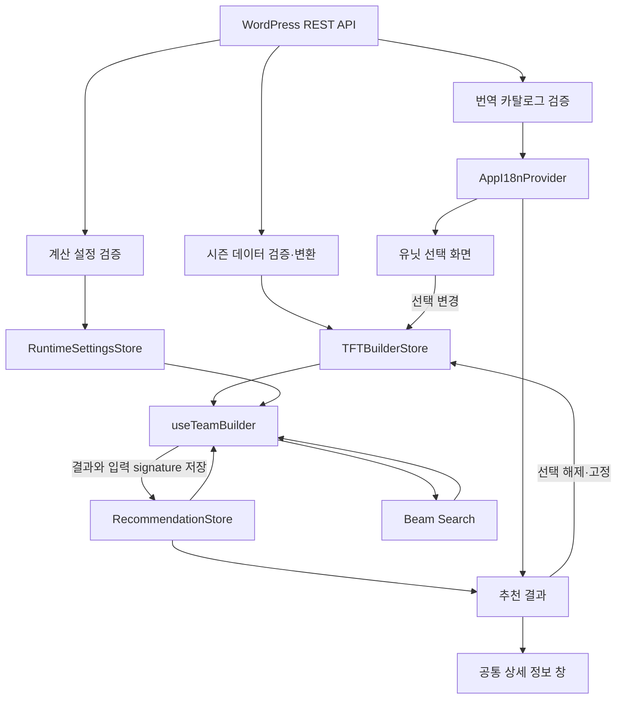

# TFT 팀 조합 추천기 — 프로젝트 소개와 주요 설계

1인 개발 프로젝트 · 2026.01.05 ~ 진행 중

사용자가 고른 후보 유닛, 반드시 포함할 고정 유닛, 추가 상징을 바탕으로 점수가 높은 팀 조합을 추천하는 React 애플리케이션입니다. 하나의 프런트엔드 코드를 WordPress 웹과 Capacitor 기반 Android 앱에서 함께 사용하며, 시즌 데이터와 계산 설정은 WordPress REST API로 받아옵니다.

개발하면서 가장 신경 쓴 부분은 기능이 늘어나도 선택 상태와 계산 결과가 서로 어긋나지 않도록 만드는 일이었습니다. 추천 탭을 추가하면서 작업별 상태를 나눠야 했고, 서버 응답을 사용하는 과정에서는 요청 성공과 데이터의 유효성을 구분해야 했습니다. WordPress의 공통 CSS와 모바일 터치 동작처럼 개발 서버에서만 확인하기 어려운 문제도 있었습니다.

이 문서에서는 그 과정에서 정리한 다섯 가지 설계를 **처음 방식 → 발생 문제 → 최종 해결 → 개선 결과** 순서로 설명합니다. 해결 방법마다 적용한 코드와 대안을 함께 적었습니다. 수치는 코드에서 확인할 수 있는 설정과 이론적인 연산량을 기준으로 하며, 별도로 측정하지 않은 실행 시간이나 성능 향상률은 기재하지 않았습니다.

## 전체 구조

계산, 상태 관리, 서버 데이터 처리, 화면의 책임을 나누는 관심사 분리(Separation of Concerns)를 기준으로 구성했습니다.



| 영역 | 역할 | 대표 코드 |
|---|---|---|
| 데이터 처리 | API 응답 검증, 모델 변환, 정상 데이터 보관 | [api/tftApi.ts](./api/tftApi.ts), [config/runtimeSettings.ts](./config/runtimeSettings.ts) |
| 계산 | 팀 점수 계산과 조합 탐색 | [core](./core), [domain](./domain) |
| 상태 관리 | 공용 데이터와 탭별 선택·결과 관리 | [store](./store), [team-builder/recommendationStore.ts](./team-builder/recommendationStore.ts) |
| 화면 | 선택 UI, 탭 이동, 상세 정보, 다국어 | [selector](./selector), [workspace](./workspace), [details](./details), [i18n](./i18n) |

## 기술 스택

React 19 · TypeScript · Vite · Zustand · Tailwind CSS · WordPress REST API · Capacitor Android WebView

## 1. 알고리즘 — Beam Search로 조합 탐색 범위를 제한했습니다

### 처음 방식

추천 기능을 만들 때 가장 먼저 다뤄야 했던 문제는 가능한 팀 조합의 수였습니다. 모든 팀의 점수를 계산하는 완전 탐색(Brute Force)은 최적의 조합을 찾을 수 있지만, 후보 수가 늘어나면 계산량이 빠르게 커집니다. 이 프로젝트는 첫 커밋부터 Beam Search를 사용했으며, 완전 탐색은 구현을 교체하기 전의 방식이 아니라 탐색 범위를 결정하기 위한 비교 기준입니다.

### 발생 문제

고정 유닛이나 변형 유닛 제한 없이 후보 50명 중 8명을 고르면 가능한 조합은 `C(50, 8) = 536,878,650`개입니다. 또한 같은 팀을 `A → B → C`와 `B → A → C`처럼 다른 순서로 만들면 중복 계산까지 발생할 수 있습니다.

사용자가 브라우저나 Android 앱에서 결과를 기다리는 기능인 만큼, 가능한 모든 팀을 검사하기보다는 계산 범위를 조절할 수 있는 방법이 필요했습니다.

### 최종 해결

`findBestCombinationBeam()`은 고정 유닛에서 시작해 후보를 한 명씩 추가하고, 각 단계에서 점수가 높은 일부 팀만 남깁니다. 팀 점수에는 활성 특성의 구간 점수, 서버가 판정한 OP 유닛 가산점, 코스트와 역할군 가산점을 반영합니다.

팀은 `Node`로 표현했습니다. 챔피언 ID를 정렬한 key를 `visited` Set에 기록해 선택 순서만 다른 팀을 다시 계산하지 않도록 했습니다. `baseId`가 같은 원본·변형 유닛은 한 팀에 추가하지 않습니다. 후보 섞기 옵션을 끈 상태에서는 입력 순서와 동점 처리 순서를 유지하고, 옵션을 켰을 때만 seed 기반으로 후보 순서를 섞습니다.

대안인 완전 탐색은 최적해를 보장하지만 조합 수를 감당해야 합니다. 반대로 매 단계에서 가장 높은 팀 하나만 남기는 탐욕적 선택은 더 빠르지만, 나중에 특성 조합이 좋아질 경로를 일찍 버릴 수 있습니다. 저는 여러 경로를 함께 유지하면서 탐색 폭을 조절할 수 있는 Beam Search를 선택했습니다. 다만 이 방법도 휴리스틱 탐색이므로 최적해를 보장하지는 않습니다.

### 개선 결과

기본 탐색 폭은 28, 표시 결과는 최대 5개입니다. 실제 탐색 폭은 `max(1, beamWidth, resultLimit)`이며 관리자에서 조절할 수 있습니다. 후보가 부족하면 목표 인원이나 결과 수를 채우지 못할 수 있습니다.

후보 50명, 추가할 인원 8명, 탐색 폭 28을 가정하면 후보 확장 시도는 느슨한 상한으로 `8 × 28 × 50 = 11,200`회 이내입니다. 첫 단계의 경로는 하나이고, 중복·변형 유닛 검사를 통과하지 못한 경우는 점수를 계산하지 않으므로 실제 점수 계산 횟수는 더 적습니다. 이 수치는 완성 팀 536,878,650개를 모두 평가하는 경우와 비교한 연산량 기준이며, 실행 시간 측정값은 아닙니다.

현재 구현에는 후보 정렬과 방문 기록도 있으므로 전체 복잡도를 단순히 `O(인원 × 탐색 폭 × 후보 수)`라고만 적지는 않았습니다.

| 항목 | 현재 구현의 탐색 비용 |
|---|---|
| 기호 | `n`: 후보 수, `d`: 추가할 인원, `B`: 실제 탐색 폭, `K`: 고정 유닛을 포함한 최대 팀 인원 |
| 확장 시도 | `O(dBn)` |
| 단계별 후보 정렬 합계 | 비교 기반 정렬을 가정하면 `O(dBn log(Bn))` |
| 경로 생성·평가 포함 시간 | `O(dBn × (K log K + E + log(Bn)))`. `E`는 한 팀의 특성·OP·역할 점수 계산 비용이며, `Node` 생성자의 정렬 비용도 포함했습니다. |
| 팀 경로·방문 key 공간 | 고정 길이 ID를 가정하면 최악 `O(dBnK)`. `visited`는 단계가 끝나도 유지되므로 공간이 탐색 폭 `B`에만 비례하지 않습니다. |

위 분석은 탐색 루프에 대한 상한입니다. 원본 데이터용 Map 구성과 최종 결과의 상세 특성 생성 비용은 별도로 발생합니다. 탐색 폭을 키우면 더 많은 경로를 확인하는 대신 시간과 메모리를 더 사용하므로, 관리자 설정으로 이 트레이드오프를 조절하도록 했습니다.

관련 코드: [beamSearchOptimizer.ts](./core/beamSearchOptimizer.ts), [Node.ts](./core/Node.ts), [traitEvaluator.ts](./core/traitEvaluator.ts), [candidateOrder.ts](./core/candidateOrder.ts)

## 2. 상태 관리 — 공용 데이터와 탭별 작업을 분리했습니다

### 처음 방식

초기 구현부터 후보 유닛, 고정 유닛, 상징 선택은 Zustand store에서 함께 관리했습니다. 반면 팀 인원과 추천 결과는 `useTeamBuilder`의 컴포넌트 내부 상태로 보관했습니다. 하나의 추천 작업을 다룰 때는 이 구조로 충분했습니다.

### 발생 문제

추천 하위 탭을 추가하자 탭마다 서로 다른 선택과 결과를 유지해야 했습니다. 모든 탭이 하나의 선택값을 공유하면 다른 조합을 비교하기 어렵고, 결과만 계속 보관하면 입력을 바꾼 뒤에도 예전 결과가 현재 결과처럼 보일 수 있었습니다.

따라서 상태를 어디에 저장할지뿐 아니라, 저장한 결과가 현재 입력에 유효한지도 함께 다뤄야 했습니다.

### 최종 해결

챔피언·특성 원본 데이터는 `TFTBuilderStore`에 공통으로 두고, 후보·고정 유닛과 상징 선택은 `selectionSessions`에 탭 ID별로 저장했습니다. 팀 인원, 후보 섞기 여부, 추천 결과는 `RecommendationStore.sessions`에 같은 탭 ID로 연결했습니다.

화면은 store의 action을 호출하고 변경된 상태를 구독합니다. 이 단방향 데이터 흐름을 유지하면서 `toggle()`과 `toggleFixed()`에서 같은 `baseId`의 유닛을 반대 목록에서 제거하도록 했습니다. 후보·고정 화면이 각각 상태를 맞추는 대신, 같은 변경 규칙을 사용하도록 한 것입니다.

추천할 때는 선택값, 팀 인원, 후보 섞기 여부, 서버 계산 설정과 버전, 계산에 참여하는 챔피언 정보와 특성 규칙을 정렬·직렬화한 `signature`를 결과와 함께 저장합니다. 현재 signature와 다르면 결과를 숨기고 snapshot을 무효화해 재계산이 필요하다고 표시합니다.

대안으로 탭마다 별도의 store와 데이터 복사본을 만들 수도 있습니다. 하지만 같은 시즌 데이터를 탭 수만큼 보관하고 갱신해야 합니다. 모든 입력 변경 이벤트에 결과 초기화 코드를 붙이는 방식도 가능하지만, 서버 역할군이나 가중치 변경처럼 별도 경로에서 바뀐 조건을 놓칠 수 있습니다. 저는 공용 데이터는 공유하고 작업 상태만 분리하며, 결과의 유효성은 계산 입력 전체로 확인하는 방식을 선택했습니다.

### 개선 결과

기본 추가 탭 수는 2개로, 총 3개의 추천 작업을 독립적으로 비교할 수 있습니다. 탭을 이동해도 선택과 결과가 유지되고, 탭을 복사하면 Set과 Map을 새로 만들어 이후 선택 변경이 원본 탭에 영향을 주지 않습니다. 이는 새로고침 이후의 영구 저장이 아니라 실행 중 메모리에서 유지하는 상태입니다.

공용 데이터 크기를 `D`, 탭 수를 `T`, 탭당 선택·설정·결과 크기를 `S`라고 하면 저장 구조의 공간은 대략 `O(D + TS)`입니다. 탭마다 원본까지 복제하는 `O(T(D + S))` 구조를 피했습니다.

이 설계의 주된 개선은 계산 속도보다 상태의 일관성입니다. signature는 단순한 상수 시간 플래그가 아니라 데이터 순회·정렬·직렬화 비용이 들며, 관련 입력이 바뀔 때 `useMemo`에서 다시 만듭니다. 이 비용을 받아들이는 대신 서버 데이터 변경까지 포함해 오래된 결과를 구분하도록 했습니다.

관련 코드: [useTFTBuilderStore.ts](./store/useTFTBuilderStore.ts), [recommendationStore.ts](./team-builder/recommendationStore.ts), [recommendationSignature.ts](./team-builder/recommendationSignature.ts), [useTeamBuilder.ts](./team-builder/hooks/useTeamBuilder.ts)

## 3. 선택 화면 — 모드별 조건을 Strategy로 모았습니다

### 처음 방식

후보 유닛과 고정 유닛 화면은 초기부터 공통 `ChampionSelector`를 사용했습니다. 화면 종류를 나타내는 `mode`를 하위 컴포넌트와 훅에 전달하고, 각 위치에서 후보 모드인지 확인해 사용할 상태와 함수를 골랐습니다.

### 발생 문제

화면을 복사하지는 않았지만 `mode === "candidate"` 같은 조건이 여러 파일에 퍼졌습니다. 어떤 목록을 표시할지, 선택·전체 해제에 어떤 함수를 연결할지, 색상과 필터는 어떻게 달라지는지를 여러 곳에서 확인해야 했습니다. 화면별 차이가 늘어날수록 변경 범위를 파악하기 어려워졌습니다.

### 최종 해결

공통 검색·카드·목록 컴포넌트는 유지하고, 차이만 `ChampionSelectorStrategy` 인터페이스로 모았습니다. 후보 전략은 `selectedChampions`, `toggle`, `clearSelected`를 연결하고, 고정 전략은 `fixedChampions`, `toggleFixed`, `clearFixed`를 연결합니다. 선택 색상과 문구, 코스트·역할군 일괄 선택 버튼 표시 여부도 전략 설정을 사용합니다.

`useChampionSelector`는 전달받은 selector로 상태와 action을 구독합니다. 이처럼 공통 흐름은 유지하고 달라지는 동작을 외부에서 전달하는 Strategy 패턴으로 정리했습니다.

화면을 두 개로 나누면 각 화면은 단순해지지만 검색·카드 수정이 중복됩니다. 반대로 모드별 조건문을 계속 유지하면 파일 수는 적어도 차이를 여러 곳에서 관리해야 합니다. 저는 두 화면의 공통 UI가 크고 동작 차이는 명확했기 때문에, 별도의 클래스 계층 대신 타입이 있는 설정 객체와 함수로 분리했습니다.

### 개선 결과

두 화면은 하나의 공통 UI와 두 개의 전략 설정을 사용합니다. 공통 카드나 검색을 바꾸면 양쪽에 반영되고, 화면별 action 연결은 `selectorStrategies.ts`에서 확인할 수 있습니다. 새 모드를 추가할 때는 관련 타입과 전략, 화면 연결을 확장하는 방향으로 작업할 수 있습니다.

이 변경은 실행 시간이나 공간복잡도를 줄이는 최적화는 아닙니다. 검색과 목록 처리는 그대로이며, 개선한 부분은 조건 분기의 위치와 수정 범위입니다. 후보·고정 action이 잘못 연결되지 않는지도 테스트로 확인할 수 있도록 했습니다.

관련 코드: [selectorStrategies.ts](./selector/champion-selector/selectorStrategies.ts), [ChampionSelector.tsx](./selector/champion-selector/ChampionSelector.tsx), [useChampionSelector.ts](./selector/champion-selector/hooks/useChampionSelector.ts)

## 4. 서버 데이터 — 응답 검증과 마지막 정상 데이터 유지로 경계를 만들었습니다

### 처음 방식

초기에는 외부 JSON을 받아 필요한 챔피언·특성 정보로 가공해 store에 저장했습니다. HTTP 응답이 성공하면 내부 데이터도 사용할 수 있다고 보는 흐름이었고, 현재처럼 응답 구조를 명시적으로 검사하는 경계는 없었습니다.

### 발생 문제

시즌 데이터와 설정을 서버에서 제공하도록 구성하면서, 요청 성공과 데이터의 유효성이 별개라는 점이 중요해졌습니다. 필수 필드가 빠지거나 스키마가 달라질 수 있고, 개수 메타데이터와 실제 배열 길이, 숫자나 이미지 주소가 잘못될 수도 있었습니다.

또한 여러 화면이 같은 데이터를 요청하거나, 정상 사용 중 재요청이 실패하는 경우도 처리해야 했습니다. TypeScript의 정적 타입 검사만으로는 실행 중에 받은 JSON의 내용을 보장할 수 없었습니다.

### 최종 해결

시즌 응답은 `parseTFTDatasetPayload(value: unknown)`을 거칩니다. 스키마 버전, 필수 필드와 숫자 형태, 메타데이터와 실제 배열 개수의 일치 여부 등을 검사한 뒤 앱 모델로 변환합니다. 이미지 URL은 허용한 프로토콜인지 확인하고, `assetBaseUrl`이 설정되어 있으면 해당 경로 안의 주소인지도 검사합니다. 이 검사는 구조적 호환성을 확인하며, 최신 시즌인지나 데이터 내용이 게임의 실제 수치와 같은지까지 보장하지는 않습니다.

데이터 요청 Promise인 `tftDataRequest`를 공유해 같은 캐시를 사용하는 호출의 중복 요청을 줄였습니다. 정상 응답은 `lastGoodSessionData`에 보관하고, 재요청이 실패하면 마지막 정상 데이터를 반환합니다. 정상 데이터가 한 번도 없으면 오류를 표시하며, 이 캐시는 실행 중 메모리에만 유지합니다.

계산 설정은 허용 범위로 보정하고 해석할 수 없는 항목은 기본값으로 대체합니다. 요청 실패나 스키마 불일치처럼 새 설정을 적용하지 못한 경우에는 기존 설정을 유지합니다. 번역 카탈로그도 스키마와 요청 언어, 버전 필드를 확인하고 누락된 문구는 번들 기본 문구로 보완합니다.

타입 단언만 사용하는 방식은 검사 비용이 적지만 실제 응답을 검증하지 않습니다. 모든 실패에서 데이터를 비우는 방식은 상태를 단순하게 만들지만 일시적인 네트워크 장애가 곧 화면 중단으로 이어집니다. 저는 앱에 들어오는 지점에서 검증하고 마지막 정상 데이터를 유지하는 방식을 선택했습니다. 대신 장애 중에는 최신이 아닌 데이터를 보여 줄 수 있다는 한계가 있습니다.

### 개선 결과

정상적으로 파싱된 데이터만 내부 모델에 반영하고, 동일한 캐시를 사용하는 여러 화면은 하나의 데이터 요청 결과를 공유합니다. 갱신할 때 요청 캐시는 초기화하지만 마지막 정상 데이터는 유지하므로, 일시적인 실패에서 기존 화면을 이어 갈 수 있습니다.

화면 복귀·포커스·온라인 이벤트에서는 시즌 데이터와 계산 설정을 재확인하되, 최근 갱신 시도 후 15초 이내의 이벤트는 합칩니다. 이는 15초 주기 polling이 아니라 이벤트 기반 재확인입니다. 서버 데이터가 기존 클라이언트 스키마와 호환되면 설치된 Android 앱도 다시 빌드하지 않고 갱신된 데이터를 받을 수 있습니다.

응답에서 검사하는 전체 필드·배열 항목 수를 `P`라고 하면 구조 검증은 대체로 `O(P)`이며, 변환한 데이터와 마지막 정상 snapshot을 보관하는 공간도 데이터 크기에 비례합니다. 별도의 캐싱 라이브러리를 추가하지 않고 필요한 동작을 구현했지만, 검증 규칙과 캐시 갱신 정책은 직접 관리해야 합니다.

관련 코드: [tftApi.ts](./api/tftApi.ts), [runtimeSettings.ts](./config/runtimeSettings.ts), [useRuntimeDataRefresh.ts](./workspace/hooks/useRuntimeDataRefresh.ts), [translationApi.ts](./i18n/translationApi.ts), [translationCatalog.ts](./i18n/translationCatalog.ts)

## 5. 화면 사용성 — 실제 배포 환경에 맞춰 렌더링과 입력을 조정했습니다

### 처음 방식

초기 화면은 탭과 챔피언 목록을 한꺼번에 렌더링했습니다. 개발 서버에서 기능과 배치를 먼저 확인했지만, 같은 React 코드라도 WordPress의 공통 스타일과 Android WebView의 터치 환경에서는 다른 문제가 나타났습니다.

### 발생 문제

WordPress·Elementor의 버튼 스타일이 앱 내부에 적용되어 모양이 달라졌습니다. 모바일에서는 사용하지 않는 탭과 카드까지 처음에 만들었고, 세로 스크롤이 좌우 탭 이동으로 인식되는 경우도 있었습니다. 상세 정보 창은 카드나 탭의 부모 영역에 있는 `overflow` 때문에 잘릴 수 있었습니다.

각 문제는 원인이 달랐기 때문에 화면 전체를 한 번에 바꾸기보다 스타일, 렌더링 시점, 입력 판정, 상세 정보 표시를 나눠 조정했습니다.

### 최종 해결

WordPress 스타일 충돌은 앱 루트인 `.tft-app` 안의 버튼을 구체적인 selector로 재정의해 대응했습니다. iframe이나 Shadow DOM은 더 강하게 스타일을 격리할 수 있지만, 기존 WordPress 마운트 구조와 별도의 경계를 연결해야 합니다. 현재는 충돌이 확인된 컨트롤을 같은 DOM 안에서 보정하는 범위의 스타일 격리를 사용합니다.

탭은 `mountedModes`로 방문 여부를 기록해 처음 방문할 때만 마운트하고, 방문한 탭은 유지합니다. 탭을 이동할 때마다 언마운트하는 방법보다 메모리는 더 사용하지만 다시 들어왔을 때 화면을 재생성하는 작업을 줄일 수 있습니다. 비활성 탭에는 `inert`와 `content-visibility: hidden`도 적용했습니다.

챔피언·상징 목록은 `useProgressiveRenderCount`로 일부 항목부터 표시하고, `IntersectionObserver`가 목록 끝부분의 접근을 감지하면 다음 항목을 추가합니다. 화면 밖 항목을 제거하는 가상 스크롤도 대안이지만, 카드 배치와 상세 정보 버튼을 유지하는 현재 구조에는 점진적 렌더링을 선택했습니다. 따라서 스크롤할수록 DOM은 늘어나며, 목록 전체의 메모리를 항상 일정하게 유지하는 방식은 아닙니다.

터치는 가로 이동이 48px 이상이고 세로 이동의 1.4배를 초과할 때만 인접 탭으로 전환합니다. 상세 정보는 카루셀 바깥이면서 앱 루트 내부에 있는 공통 host로 React Portal을 사용해 표시합니다. 부모의 `overflow`를 모두 풀면 탭 레이아웃에도 영향을 줄 수 있어, 상세 정보의 DOM 위치를 분리했습니다.

마지막으로 탭의 좌우 방향키·Home·End 이동, 상세 정보 창의 Escape 닫기와 닫기 버튼 사용 시 포커스 복귀를 처리했습니다. 탭 이동 스크롤은 `prefers-reduced-motion` 설정도 따르도록 했습니다.

### 개선 결과

코드에서 확인할 수 있는 초기 렌더링 수와 입력 기준은 다음과 같습니다.

| 항목 | 적용 결과 |
|---|---|
| 상위 작업 탭 | 5개 중 현재 탭의 내용부터 마운트하고, 이후 방문한 탭을 유지 |
| 챔피언 카드 | 모바일 8개, 태블릿 12개, 데스크톱 18개부터 표시 |
| 상징 항목 | 모바일 6개, 태블릿 10개, 데스크톱 14개부터 표시 |
| 터치 판정 | 가로 48px 이상이면서 세로 이동의 1.4배 초과 시 탭 전환 |

위 목록 개수는 전체 항목 수가 더 적으면 그 수로 제한되며, observer가 이어서 항목을 추가할 수 있습니다. 필터링 이후 목록 크기가 `N`, 최초 표시 수가 `p`일 때 처음 만드는 항목 컴포넌트 수를 `N`개에서 `min(N, p)`개로 제한했습니다. 전체 데이터 불러오기와 검색의 순회 비용까지 줄인 것은 아니며, 모든 항목을 표시한 뒤의 DOM 공간은 여전히 `O(N)`입니다.

렌더링 부담 외에도 세로 스크롤과 탭 이동의 판정 기준이 명확해졌고, 상세 정보 창을 카루셀의 잘림 영역 밖에 표시할 수 있게 됐습니다. 실제 로딩 시간이나 프레임 개선율은 별도로 측정하지 않았으므로, 성과는 이러한 동작과 초기 생성 항목 수를 기준으로 정리했습니다.

관련 코드: [TftWorkspace.tsx](./workspace/TftWorkspace.tsx), [useWorkspaceCarousel.ts](./workspace/hooks/useWorkspaceCarousel.ts), [carouselNavigation.ts](./workspace/carouselNavigation.ts), [useProgressiveRenderCount.ts](./selector/hooks/useProgressiveRenderCount.ts), [DetailPopover.tsx](./details/DetailPopover.tsx), [wordpressButtonIsolation.css](./styles/wordpressButtonIsolation.css)

## 검증

프로젝트의 핵심 회귀 테스트는 `vite-project`에서 실행합니다.

```bash
npm run test:core
```

알고리즘의 재현성, 입력 변경에 따른 결과 무효화, 탭별 상태 분리, 전략별 action 연결, 서버 응답 검증과 마지막 정상 데이터 유지 등을 확인합니다. 렌더링 개수와 터치 판정에 대한 테스트도 포함되어 있습니다. 이 테스트는 기능과 규칙을 검증하며, 실제 기기의 로딩 시간이나 사용자 경험을 측정하는 성능 벤치마크는 아닙니다.

이 과정을 거치며 계산은 탐색 범위로, 상태는 세션과 입력 signature로, 외부 데이터는 검증 경계로 관리하도록 정리했습니다. 화면에서는 실제 배포 환경에서 나타난 문제를 기준으로 렌더링과 입력 방식을 조정했습니다. 기능을 추가할 때도 어느 영역의 책임인지 먼저 확인할 수 있다는 점이 현재 구조에서 얻은 가장 큰 변화입니다.
