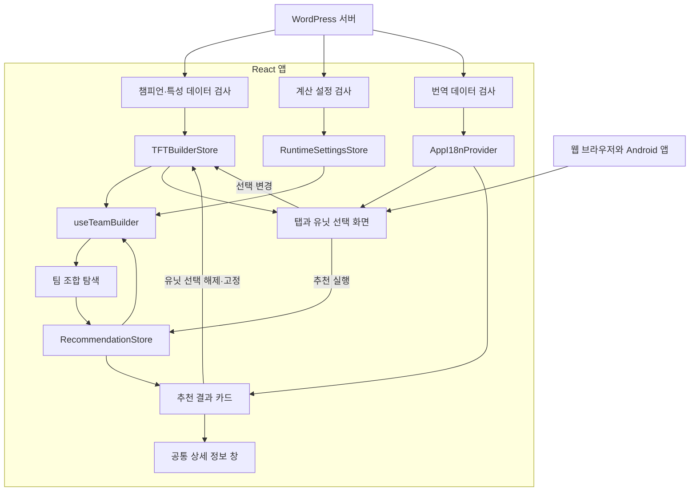
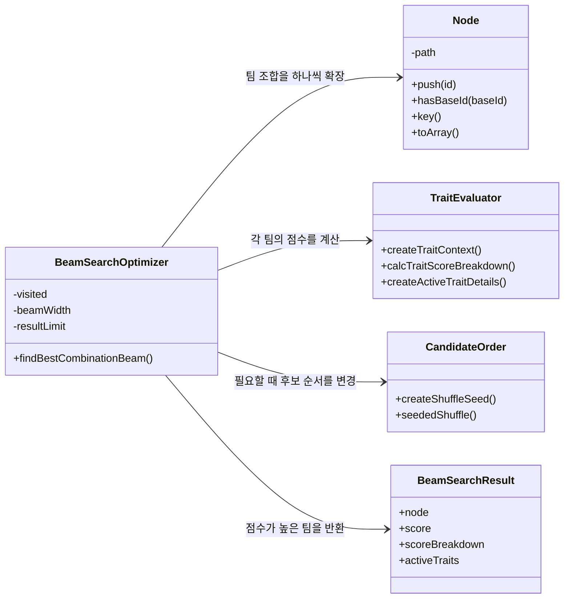
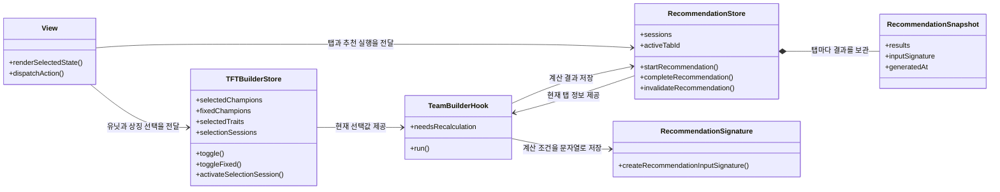
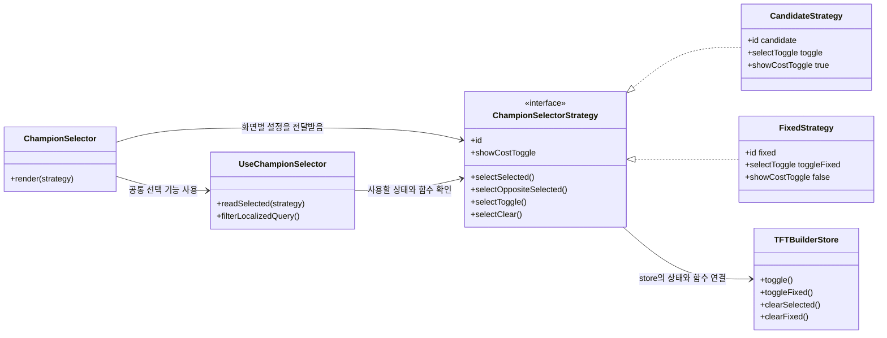
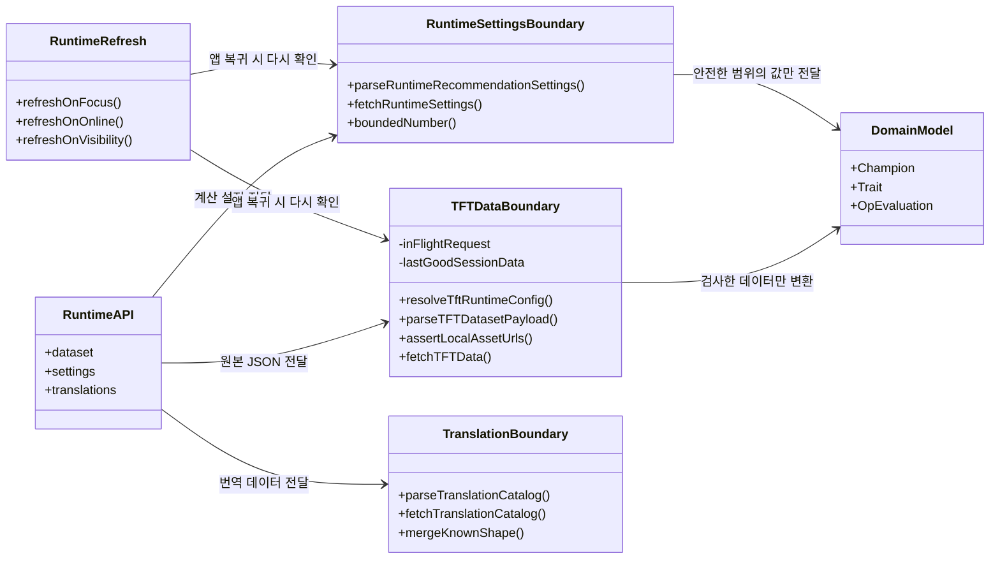
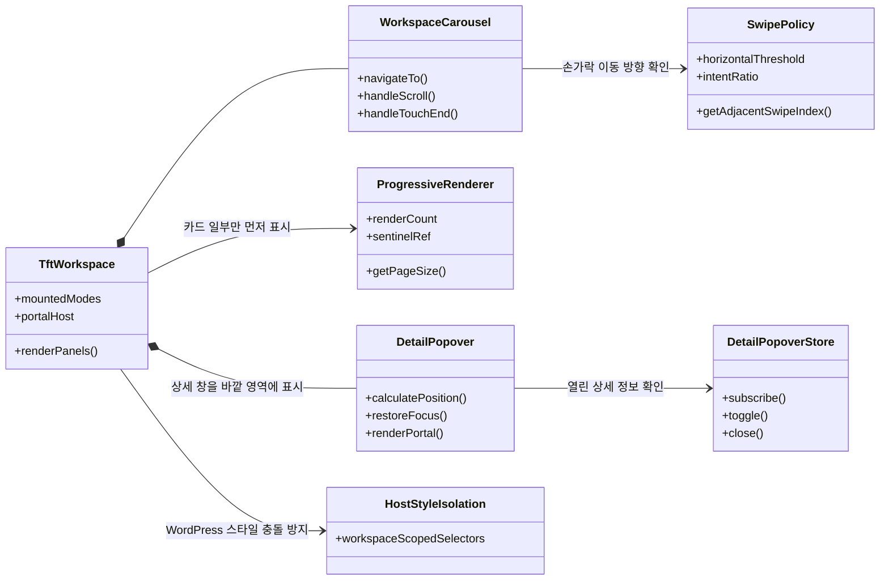

# TFT 팀 조합 추천기 — 프로젝트 소개와 주요 설계

1인 개발 프로젝트 · 2026.01.05 ~ 진행 중

사용자가 고른 후보 유닛, 반드시 포함할 고정 유닛, 추가 상징을 이용해 점수가 높은 팀을 추천하는 React 애플리케이션입니다. 하나의 프런트엔드 코드를 WordPress 웹과 Android 앱에서 함께 사용하며, 새 시즌 데이터와 계산 설정은 서버에서 받아옵니다.

처음에는 챔피언을 고르고 계산 버튼을 누르면 끝나는 화면이라고 생각했습니다. 후보가 적고 화면이 하나일 때는 실제로 그렇게 동작했습니다. 하지만 후보 수를 늘리자 계산 시간이 눈에 띄게 길어졌고, 탭을 오가며 선택을 바꾸면 서로 다른 화면의 상태가 어긋나기 시작했습니다. 개발 서버에서 멀쩡하던 버튼과 스크롤은 WordPress에 올리자 달라졌고, 같은 React 빌드를 사용하는 Android 앱이 서버와 다른 시즌 데이터를 보여 주는 경우도 생겼습니다.

이 문제들을 해결하면서 단순히 기능을 추가하는 것보다, 데이터와 화면이 어떤 순서로 동작해야 하는지를 먼저 정리했습니다. 이 문서는 `src/features`의 현재 코드를 기준으로, 중요하다고 생각한 설계 5가지를 이해하기 쉽게 설명합니다.

## 전체 구조



| 영역 | 하는 일 | 대표 코드 |
|---|---|---|
| 데이터 불러오기 | 서버 주소 확인, 받은 JSON 검사, 마지막 정상 데이터 보관 | [`api/tftApi.ts`](./api/tftApi.ts), [`config/runtimeSettings.ts`](./config/runtimeSettings.ts) |
| 계산 | 챔피언과 특성 정보 관리, 팀 점수 계산, 좋은 조합 탐색 | [`domain`](./domain), [`core`](./core) |
| 상태 관리 | 서버 데이터와 탭별 선택값, 추천 결과 관리 | [`store`](./store), [`team-builder/recommendationStore.ts`](./team-builder/recommendationStore.ts) |
| 화면 | 유닛 선택, 다국어, 반응형 탭, 상세 정보 창 | [`selector`](./selector), [`i18n`](./i18n), [`workspace`](./workspace), [`details`](./details) |

## 기술 스택

- React 19, TypeScript, Vite
- Zustand를 이용한 상태 관리
- Tailwind CSS와 WordPress 전역 스타일 충돌 방지 CSS
- WordPress REST API를 이용한 데이터 전달
- Capacitor Android WebView

## 주요 설계 5가지

각 항목은 `처음 방식 → 발생한 문제 → 바꾼 방법 → 결과` 순서로 설명합니다.

### 1. 알고리즘 — 너무 많은 조합을 Beam Search로 줄였다

처음에는 만들 수 있는 모든 팀을 계산한 뒤 점수가 가장 높은 팀을 고르려고 했습니다. 후보가 적을 때는 문제가 없었지만, 후보 50명 중 8명을 고르는 경우에는 가능한 조합이 536,878,650개나 됩니다. 후보가 늘어날수록 사용자가 결과를 오래 기다려야 했습니다.

이를 해결하기 위해 매 단계에서 점수가 높은 조합 일부만 남기는 **Beam Search**를 사용했습니다. 챔피언을 한 명 추가할 때마다 상위 조합만 다음 계산으로 넘기기 때문에, 모든 경우를 끝까지 확인하지 않아도 좋은 결과를 찾을 수 있습니다.

같은 팀이 선택 순서만 다르게 중복 계산되지 않도록 챔피언 ID를 정렬해 팀의 고유 key를 만들었습니다. 같은 챔피언의 변형 유닛은 `baseId`로 확인해 한 팀에 중복으로 들어가지 않게 했습니다. 후보 섞기 옵션을 켰을 때만 seed를 이용해 순서를 바꾸므로, 기본 상태에서는 같은 입력에 같은 결과가 나옵니다.

기본 설정은 한 단계마다 28개 조합을 남기고 최종 결과 5개를 보여 줍니다. 모든 경우를 검사하는 방식보다 훨씬 적은 계산으로 결과를 얻는 대신, 항상 이론상 최고의 조합을 찾는다고 보장할 수는 없습니다. 이 값들은 WordPress 관리자에서 조절할 수 있어 계산 속도와 결과 품질의 균형을 맞출 수 있습니다.



관련 코드: [`core/beamSearchOptimizer.ts`](./core/beamSearchOptimizer.ts), [`core/Node.ts`](./core/Node.ts), [`core/traitEvaluator.ts`](./core/traitEvaluator.ts), [`core/candidateOrder.ts`](./core/candidateOrder.ts)

### 2. Flux — 상태가 바뀌는 흐름을 한 방향으로 정리했다

처음에는 후보 화면과 고정 유닛 화면이 각자 선택값을 관리했습니다. 그러자 같은 챔피언이 후보와 고정 목록에 동시에 남거나, 화면을 이동했을 때 추천 결과가 사라지는 문제가 생겼습니다. 반대로 결과만 전역에 저장하니 선택값을 바꾼 뒤에도 예전 결과가 현재 결과처럼 보였습니다.

이를 해결하기 위해 화면은 사용자의 동작만 전달하고, 실제 상태 변경은 Zustand store에서 처리하도록 만들었습니다. 이것이 이 프로젝트에서 사용한 **Flux 스타일의 단방향 흐름**입니다. 예를 들어 유닛을 고정 목록에 넣으면 store가 같은 챔피언을 후보 목록에서 자동으로 제거합니다. 이 규칙이 한곳에 있으므로 어느 화면에서 선택하더라도 결과가 같습니다.

추천을 실행할 때는 후보, 고정 유닛, 상징, 팀 인원, 서버 설정 등을 하나의 문자열로 만들어 결과와 함께 저장합니다. 이 값을 `signature`라고 부릅니다. 사용자가 선택이나 설정을 바꾸면 현재 signature가 달라지므로 이전 결과를 숨기고 다시 계산해야 한다고 표시합니다.

추천 하위 탭마다 선택값과 결과도 따로 저장합니다. 따라서 여러 조합을 각각 계산해 비교할 수 있고, 탭을 이동해도 작업 내용이 유지됩니다. 챔피언과 특성 원본 데이터만 모든 탭이 함께 사용합니다.



관련 코드: [`store/useTFTBuilderStore.ts`](./store/useTFTBuilderStore.ts), [`team-builder/recommendationStore.ts`](./team-builder/recommendationStore.ts), [`team-builder/recommendationSignature.ts`](./team-builder/recommendationSignature.ts), [`selector/champion-selector/selectorStrategies.ts`](./selector/champion-selector/selectorStrategies.ts)

### 3. 디자인 패턴 — Strategy 패턴으로 비슷한 선택 화면을 하나로 만들었다

후보 유닛 화면과 고정 유닛 화면은 검색창, 선택 목록, 카드 모양이 거의 같습니다. 다른 점은 사용하는 선택값과 버튼 동작, 선택 색상, 코스트 필터 표시 여부입니다. 두 화면을 따로 만들면 같은 코드를 반복하게 되고, 한쪽만 수정해서 동작이 달라질 가능성이 있습니다.

그래서 공통 화면은 `ChampionSelector` 하나로 만들고, 화면별 차이만 `ChampionSelectorStrategy`에 모았습니다. 후보 전략은 후보 목록과 `toggle` 함수를 사용하고, 고정 전략은 고정 목록과 `toggleFixed` 함수를 사용합니다. 공통 화면은 어떤 전략인지 자세히 알 필요 없이 전달받은 설정과 함수를 사용합니다.

이 방식을 **Strategy 패턴**이라고 합니다. 새로운 선택 방식을 추가할 때 기존 카드와 검색 코드를 복사하지 않고 새로운 전략만 추가할 수 있습니다. 처음에는 설정 파일이 하나 더 필요하지만, 중복 코드와 여러 곳에 퍼지는 조건문을 줄일 수 있습니다.



관련 코드: [`selector/champion-selector/selectorStrategies.ts`](./selector/champion-selector/selectorStrategies.ts), [`selector/champion-selector/ChampionSelector.tsx`](./selector/champion-selector/ChampionSelector.tsx), [`selector/champion-selector/hooks/useChampionSelector.ts`](./selector/champion-selector/hooks/useChampionSelector.ts)

### 4. 서버 데이터 — 받은 데이터를 확인한 뒤 앱에서 사용했다

처음에는 서버 요청이 성공하면 받은 JSON을 바로 store에 저장했습니다. 하지만 HTTP 요청이 성공해도 필드가 빠져 있거나, 이전 버전 데이터가 오거나, 챔피언 개수가 잘못될 수 있습니다. TypeScript 타입은 개발 중 실수를 줄여 주지만 실제 서버 응답까지 자동으로 검사해 주지는 않습니다.

그래서 서버 데이터는 먼저 `unknown`으로 받은 뒤 앱이 기대하는 모양인지 확인합니다. 데이터 버전, 필수 필드, 챔피언과 특성 개수, 숫자 값, 이미지 주소를 검사하고 모두 정상일 때만 앱에서 사용하는 형태로 변환합니다. 여러 화면이 동시에 같은 데이터를 요청하면 하나의 진행 중인 요청을 함께 사용해 중복 호출도 줄였습니다.

새 요청이 일시적으로 실패했을 때는 화면을 비우지 않고 현재 실행 중인 앱에서 마지막으로 정상 수신한 데이터를 계속 보여 줍니다. 계산 설정도 너무 크거나 작은 값이 들어오지 않도록 범위를 제한하고, 문제가 있으면 앱에 포함된 기본값을 사용합니다. 번역 데이터 역시 요청한 언어와 데이터 버전을 확인한 뒤 적용합니다.

앱이 다시 화면에 나타나거나 인터넷 연결이 돌아오면 데이터를 새로 확인합니다. 덕분에 웹과 이미 설치된 Android 앱은 다시 빌드하지 않아도 새 시즌 데이터를 받을 수 있고, 서버나 네트워크에 잠깐 문제가 생겨도 사용 중인 화면을 최대한 유지할 수 있습니다.



관련 코드: [`api/tftApi.ts`](./api/tftApi.ts), [`config/runtimeSettings.ts`](./config/runtimeSettings.ts), [`workspace/hooks/useRuntimeDataRefresh.ts`](./workspace/hooks/useRuntimeDataRefresh.ts), [`i18n/translationApi.ts`](./i18n/translationApi.ts), [`i18n/translationCatalog.ts`](./i18n/translationCatalog.ts), [`store/useTFTBuilderStore.ts`](./store/useTFTBuilderStore.ts)

### 5. 화면 사용성 — 웹과 Android에서 같은 사용 경험을 만들었다

개발 서버에서는 정상인 화면도 WordPress에 넣으면 Elementor의 공통 버튼 스타일과 충돌했습니다. 모바일에서는 모든 탭과 카드를 처음부터 화면에 만들기 때문에 첫 화면이 늦게 나타났고, 세로로 스크롤하는 동작이 옆 탭 이동으로 잘못 인식되기도 했습니다.

WordPress 스타일이 앱 내부 버튼을 바꾸지 못하도록 앱의 최상위 영역 안에서 스타일을 다시 지정했습니다. 탭은 사용자가 한 번이라도 방문했을 때만 내용을 만들고, 긴 챔피언 목록은 화면 크기에 맞는 개수만 먼저 보여 줍니다. 사용자가 목록 아래쪽에 가까워지면 `IntersectionObserver`가 다음 카드를 추가합니다.

손가락 이동은 가로 방향으로 48px 이상이고 세로 이동보다 충분히 클 때만 탭 전환으로 판단합니다. 그래서 세로 스크롤 중에 실수로 옆 탭으로 넘어가는 현상을 줄였습니다. 챔피언과 특성의 상세 정보 창은 React Portal을 이용해 화면 가장 바깥쪽에 표시하여 부모 영역에 잘리지 않게 했습니다.

키보드 방향키, Home·End, Escape 키와 포커스 복귀도 함께 처리했습니다. 또한 애니메이션을 줄이도록 설정한 사용자의 환경을 따르며, 터치 버튼은 누르기 쉬운 크기를 유지합니다. 이 방식으로 WordPress 웹과 Android WebView가 같은 코드와 비슷한 조작 방식을 사용합니다.



관련 코드: [`workspace/hooks/useWorkspaceCarousel.ts`](./workspace/hooks/useWorkspaceCarousel.ts), [`workspace/carouselNavigation.ts`](./workspace/carouselNavigation.ts), [`selector/hooks/useProgressiveRenderCount.ts`](./selector/hooks/useProgressiveRenderCount.ts), [`details/DetailPopover.tsx`](./details/DetailPopover.tsx), [`styles/wordpressButtonIsolation.css`](./styles/wordpressButtonIsolation.css)

## 검증 방법

```bash
npm run test:core
npm run lint
npm run build
```

테스트에서는 팀 조합 순서와 점수, 서버 데이터 검사, 마지막 정상 데이터 유지, 후보·고정 유닛의 중복 방지, 입력 변경 후 이전 결과 숨김, 다국어 적용, 모바일 손가락 동작, 카드 나눠 그리기, WordPress 스타일 충돌 방지를 확인합니다. 마지막으로 실제 배포용 빌드가 정상적으로 만들어지는지도 검사합니다.

## 설계 원칙 요약

- 가능한 모든 경우를 계산하기보다 필요한 계산량을 정해 응답 시간을 관리합니다.
- 화면은 사용자의 동작을 전달하고, 실제 상태 변경 규칙은 store 한곳에서 관리합니다.
- 비슷한 화면은 복사하지 않고 공통 화면과 Strategy 설정으로 나눕니다.
- 서버 데이터는 바로 믿지 않고 필요한 값이 맞는지 확인한 뒤 사용합니다.
- 성능과 키보드·모바일 사용성을 기능 개발 단계부터 함께 고려합니다.
